# Risk & Compliance Copilot — Architecture Diagrams

> **Target architecture.** These diagrams cover the full design, including
> components on the roadmap. What is built is recorded in the
> [README](../README.md); design decisions made during the build are in
> [`ARCHITECTURE_DECISIONS.md`](ARCHITECTURE_DECISIONS.md).

> All diagrams are Mermaid. Render in GitHub, VS Code, Streamlit, or [mermaid.live](https://mermaid.live).

---

## Diagrams Index

> **Start with [BUILD STATUS](#build-status--read-this-before-the-diagrams).**
> The diagrams are the design intent; that section is what is actually built,
> what the trial + Standard-edition account blocks, and which diagram claims are
> now superseded.

| # | Diagram | Description |
|---|---|---|
| 1 | Entity Relationship Model | TYPOLOGY, AGENT_ACTION_LOG, SCD2 on PARTY, leg-vs-pair grain decision |
| 2 | Data Generation — Three-Layer Model | Data generation methodology: entity skeleton, behavioural ledger, narratives |
| 3 | Data Ingestion Architecture | Replay harness, sanctions feeds, policy document extraction |
| 4 | Transformation Pipeline — Two-Speed | Fast lane (seconds-to-minutes) and slow lane (daily batch) dynamic tables |
| 5 | Cross-Domain Signal Detection | Tier 1 signals to build, Tier 2 stretch goals, on-demand agent tools |
| 6 | Signal-to-Artifact Pipeline | The evidence chain from detection through attestation |
| 7 | Single Agent Architecture — Four Modes | One Cortex Agent with Sentinel, Investigator, Drafter, Reviewer modes |
| 8 | LLM Boundary | Deterministic vs. LLM responsibilities |
| 9 | Notification and Case Routing | Signal stream to case creation and notification dispatch |
| 10 | Policy Ingestion Pipeline | Document extraction, human-gated activation, two-layer output |
| 11 | Governance Mechanisms | RLS, audit trail, reproducibility, refusal, maker-checker, DMFs |
| 12 | Testing and Validation Framework | 5 test suites covering detection, SQL, groundedness, adversarial, pipeline |
| 13 | MCP and External Loop Closing | Jira, Slack, agent-as-MCP-server, scheduled automations |
| 14 | Demo Spine — One Entity, Four Lenses | Single entity traced through fraud, AML, and credit lenses |
| 15 | Complete Storage Model | Full table inventory with tier markings |
| 16 | System Boundary | Complement-not-compete design principle and system constraints |
| 17 | CoCo Lifecycle Evidence Map | Planning, Development, Execution, Testing phases |
| 18 | Replay Harness Architecture | How synthetic data enters the live pipeline |

---

# BUILD STATUS — read this before the diagrams

**Last updated:** 2026-09-27

The 18 diagrams below remain the **design intent**. This section is the **build
truth**, and where the two disagree, this section wins. Diagram-level
corrections are listed in §S4.

---

## S1. What is built and verified

| Phase | Scope | State |
|---|---|---|
| 0 | Repo scaffold, three-tier config, CLI, `doctor`, idempotent SQL deployer | **Done** |
| 1 | Bootstrap + full DDL — 38 tables across 7 schemas | **Done, deployed** |
| 2 | Data synthesis — subgraph sampling, ID maps, reskin, injection, labels, validation gates | **Done for the dev slice** — `riskcopilot --profile dev generate` passes every blocking gate on the real HI-Small files, byte-identical per seed. Demo passes every data gate (illicit 2.06%) and fails only its hero check, which needs the unbuilt rapid-credit / device-cluster cohorts. Detail: `docs/build-log.md` |
| 3 | Load, dynamic tables, streams/tasks, replay harness | **Done for the dev slice** (8 steps, see below) |
| 4 | Policy ingestion, Cortex Search, semantic view, agent, 8 procedures | **Blocked** — see §S2 |
| 5 | Governance, ML, eval suites, automations, Streamlit | **Partly blocked** — see §S3 |

Verified: `mypy --strict` clean (31 files), `ruff` clean, **555 unit tests passing**
(3 skipped: capability evidence exists only for the ASHWINRAVI004 connection, and
`conf/external.yml` now defaults to another), all SQL templates and verify
queries rendering for both profiles (14 + 6 each), every stage deployed twice
idempotently, key-pair auth working unattended with no interactive prompt,
`doctor --profile dev` 51 checks / 0 failed. The measured facts (M#) and
decisions (D#) referenced below are in `docs/build-log.md`.

**Phase 3 on RISK_COPILOT_DEV (ZC14131), as built:**

| Layer | Objects | Live state |
|---|---|---|
| RAW | 10 tables loaded by `riskcopilot load` (+ `RAW_AMLWORLD_TRANS` / `_ACCOUNTS`) | RAW_TRANSACTIONS **10,064** legs (9,862 source + 202 injected, rupees resolved from `POLICY_CLAUSE`), 2022-09-01..09-10; ledger 5,078,345 rows; 500 parties, 553 accounts |
| GROUND_TRUTH | TXN_LABELS, INJECTED_TXN_PENDING, EVAL_GRAIN_PARTY_MONTH, RAW_LAUNDERING_PATTERNS, EVAL_RUN; its own stage, no grants | 10,064 labels; 494 party-months; EVAL_RUN one row per `verify` |
| GOVERNANCE | `policy` seed stage: POLICY_CLAUSE, TYPOLOGY, RULE_DEFINITION, REF_CHANNEL | 15 clauses, 11 typologies, 1 rule (hash-locked to `sql/rules/`), 6 channels |
| CURATED | 5 dynamic tables, all `INCREMENTAL` / `ACTIVE` (DIM_PARTY, TRANSACTIONS_ENRICHED, TXN_DAILY_AGG, PARTY_RELATIONSHIP, SIGNALS_FAST) + `SIGNALS_STREAM` on SIGNALS_FAST | 10 signals, all on planted hosts |
| EVIDENCE_CHAIN | `ROUTE_SIGNALS(full_scan)` + triggered `ROUTE_SIGNALS_TASK` (suspended in dev) | SIGNAL 10, CASE_RECORD 10, CASE_SIGNAL 10 |

What Phase 3 proved (build log M30-M41):
- **Detection:** recall and precision 10/10 at party-month, and the false-positive control 0 of 1.
- **The hero:** `CONFIRMED_BY_DETECTION`, with a byte-identical result file.
- **Routing:** idempotent under a full re-feed.
- **Real triggered runs:** they route the stream's delta, with their counts in `TASK_HISTORY.RETURN_VALUE`.
- **Replay:** a hold-back load plus `riskcopilot replay` yields the same `HASH_AGG` over RAW_TRANSACTIONS as a full load, and it survived an interruption mid-run.

### Repository facts a developer needs

```
conf/            three-tier config (see below). Nothing hardcoded anywhere.
src/risk_copilot/
  config.py      layered loader, fail-fast validation, sql_context contract
  session.py     connections.toml + key-pair, bootstrap role fallback
  ids.py         deterministic identity derivation (Gap 11 below)
  hashing.py     canonical result hashing (Gap 15 below)
  doctor.py      preflight: config, datasets, connection, capabilities, models
  cli.py         single entry point -- doctor | config | deploy | generate | load | verify | replay | eval
  pipeline/      SQL deployer + offline lint; load, verify, replay
  generation/    Phase 2: source readers, Patterns parser, sampler, reskin, labels,
                 entities, relationships, injection, eval grain, gates, writer
sql/             Jinja templates, 12 ordered stages + sql/rules + sql/verify -- see sql/README.md
tests/unit/      555 offline tests; tests/fixtures/amlworld_mini is a hand-built slice
data/MANIFEST.yml  dataset registry with SHA-256; payloads gitignored
```

**Config is three tiers, and the boundaries are enforced, not conventional:**

| Tier | What | Where | Enforcement |
|---|---|---|---|
| 1 | Credentials | `~/.snowflake/connections.toml`, `cortex secret`, Snowflake `SECRET` | Never in repo; `conf/` holds secret *names* only |
| 2 | Topology (db, schema, warehouse, role, target lag) | `conf/base.yml` + `conf/profiles/{dev,demo}.yml` | `Deployer.render()` **rejects** any `.sql` containing a literal object name |
| 3 | Business thresholds (Rs 10L CTR, 3x income, `COUNT>=3`) | `GOVERNANCE.POLICY_CLAUSE` at runtime, seeded from `conf/detection.yml` | Detection SQL joins `V_POLICY_CLAUSE_CURRENT`; `doctor` fails any clause lacking provenance |

Two profiles coexist in one account: `dev` suffixes every object `_DEV` and
relaxes lags; `demo` uses canonical names and full freshness.

---

## S2. Account constraints — the dominant planning fact

**Evidence:** `conf/generated/capabilities.ASHWINRAVI004.yml` — 98 probes,
30 available. That file wins over any prose claim in this repository, including
this section. `riskcopilot doctor` reads it and auto-disables what is absent.

Account: ZC14131, **STANDARD edition, trial**, AWS_AP_SOUTHEAST_7.

### Three assumptions that were wrong — do not reintroduce them

An earlier revision of this section asserted that all Cortex AI was unavailable,
that `SNOWFLAKE.ML` required Enterprise, and that Search/Agent/Analyst were all
blocked because `AI_COMPLETE` was. The probe sweep disproved all three:

| Claimed | Actual |
|---|---|
| All Cortex AI unavailable | **Cortex Analyst works** — NL→SQL over semantic views via REST, HTTP 200, real SQL, served by `claude-sonnet-4-6`. `AI_AGG` and `AI_SUMMARIZE_AGG` work. Text-to-SQL eval (Suite 2) is scorable **now**, not deferred. |
| `SNOWFLAKE.ML` requires Enterprise | **False.** Anomaly detection, Forecast, Model Registry and Feature Store all work on Standard trial. |
| Search/Agent/Analyst blocked because `AI_COMPLETE` is | **Unsound inference.** They are gated independently, and that reasoning is what hid Analyst. Never generalise gating from one probe. |

### Works — build against these for real

| Area | Confirmed available |
|---|---|
| Critical path | Dynamic tables (+ refresh confirmed), **`STREAM ON DYNAMIC TABLE`**, tasks (warehouse + serverless), `EXECUTE TASK`, `MERGE` with unique constraint, recursive CTE, **Python stored procedures (no Anaconda blocker)**, SQL procedures, Streamlit, network rules |
| Cortex | **Cortex Analyst NL→SQL via REST**, semantic view objects + `SEMANTIC_VIEW()` querying, `AI_AGG`, `AI_SUMMARIZE_AGG`, `CREATE AGENT` (object only), `EXECUTE_AI_EVALUATION` (resolves), threads REST |
| ML | `SNOWFLAKE.ML.ANOMALY_DETECTION`, `FORECAST`, Model Registry, Feature Store |
| Other | `JAROWINKLER_SIMILARITY` / `EDITDISTANCE` / `SOUNDEX`, `CREATE TAG`, email notifications to verified addresses |

The whole pipeline critical path works. `STREAM ON DYNAMIC TABLE` in particular
was the single biggest unverified dependency — the entire `ROUTE_SIGNALS` design
rests on it.

### Blocked — trial gate (399258 / 399504 / 509009)

| Blocked | Diagram | Consequence |
|---|---|---|
| **All per-row Cortex inference** — `AI_COMPLETE` (28 models), `SNOWFLAKE.CORTEX.COMPLETE`, 3 REST surfaces. Four independent paths confirmed. | 2 (L3) | Narrative generation. This is now the **only** genuinely blocked piece of the copilot. |
| `AI_CLASSIFY` / `FILTER` / `SENTIMENT` / `EXTRACT` / `PARSE_DOCUMENT` / `TRANSLATE` / `TRANSCRIBE` / `COUNT_TOKENS` / `EMBED` / `SIMILARITY`, plus all legacy equivalents | 3, 10 | Policy ingestion by extraction; KYC-note contradiction detection |
| Cortex Search — `EMBED_TEXT_768/1024` blocked; an explicit `EMBEDDING_MODEL` does not route around it | 3, 10 | `REGULATORY_SEARCH_SVC` |
| Agent **invocation** — 399504 on all 5 paths (SQL ×2, REST ×3). Object creation succeeds. | 7, 13 | Agent-driven orchestration; see §S3 |
| External Access Integration — 509009 | 13 | Kills the Jira / Slack / MCP outbound loop |

### Blocked — Standard edition (000002 Unsupported feature)

| Blocked | Diagram | Consequence |
|---|---|---|
| Row access policies, masking, tag-based masking, aggregation and projection policies | 11 (G1) | The "same question, two roles, two answers" beat |
| Data Metric Functions | 11 (G6), 12 (Suite 5) | Pipeline-health gates, freshness qualification |
| Time Travel > 1 day | 6, 11 (G3) | `demo.yml`'s `landing_days: 14` **will fail a deploy** |

### Blocked — regional, not edition or trial

`SNOWFLAKE.ML.CLASSIFICATION` and `TOP_INSIGHTS` are not served in
AWS_AP_SOUTHEAST_7. **Converting the trial will not fix these** — they need a
different region. `AI_ESTIMATE_QUERY_COST` is parameter-disabled and
`ALTER ACCOUNT` was refused even as ACCOUNTADMIN.

### Genuinely uncertain

Two findings are inference rather than fact: the 403/003001 → trial
classification (Snowflake's message never says "trial"), and whether
`ENABLE_AI_COST_ESTIMATE` is switchable on this account at all.

### One design decision that survived the constraint

Gap 15 below replaced Time-Travel-based re-verification with a materialised
`EVIDENCE_QUERY_LOG.result_snapshot`. Because correctness never depended on
Time Travel, the Reviewer's recompute-and-compare still works under a 1-day
retention cap. Diagram 6's "RE-VERIFIABLE via Time Travel" annotation is
therefore aspirational; the snapshot is the mechanism.

---

## S3. Revised tier map

**Strategy:** build everything the evidence says works, for real. Narrative
generation is the only genuinely blocked piece of the copilot, so almost nothing
needs stubbing. Nothing waits on billing.

### Tier 1-S — buildable now on trial + Standard

| Component | Notes |
|---|---|
| L1 + L2 generation, subgraph sampling, ID maps | Pure Python |
| Typology injection + leg-level labels + eval grain | Pure Python |
| Realism validation gates | Pure Python; asserted, not claimed |
| Load + COPY INTO | Positional load for the duplicate-header CSV |
| All 8 dynamic tables + velocity views | Confirmed, including refresh |
| `SIGNALS_STREAM` + `ROUTE_SIGNALS` | `STREAM ON DYNAMIC TABLE` confirmed |
| 5 row-level + aggregate signal rules | Thresholds from `POLICY_CLAUSE` |
| Fuzzy sanctions screening | `JAROWINKLER_SIMILARITY` confirmed |
| All 8 stored procedures | Python + SQL procedures confirmed; no Anaconda blocker |
| `POLICY_CLAUSE` seeding from `conf/detection.yml` | 15 hand-authored clauses with provenance, bypassing `AI_EXTRACT` |
| Semantic view object + `SEMANTIC_VIEW()` querying | Confirmed |
| **NL→SQL over the semantic view** | **Cortex Analyst REST — confirmed working** |
| **Triage summarisation** | **`AI_AGG` / `AI_SUMMARIZE_AGG` — confirmed** |
| **`SNOWFLAKE.ML.ANOMALY_DETECTION` velocity baselines** | **Confirmed on Standard trial.** `conf/ml.yml:preconditions.require_edition` is WRONG and currently disables this working feature — fix it. |
| **Feature Store + Model Registry** | **Confirmed.** Point-in-time-correct feature retrieval is available now, not Future Scope. |
| Detection F1 eval suite (Suite 1) | Needs only labels + signals |
| **Text-to-SQL eval (Suite 2)** | **Scorable now** — Analyst works. Score on result hash via `risk_copilot.hashing`. |
| Replay harness + `--inject` | Plain `INSERT` batches |
| Streamlit app | Reads tables directly |
| `AGENT_ACTION_LOG` schema + write path | Populated by the orchestrator, agent or not |
| `CREATE AGENT` object | Deploys today; invocation is what is gated. See below. |

### Tier 1-E — genuinely deferred

| Component | Fallback on Standard trial |
|---|---|
| Agent **invocation** (399504) | Orchestrate from Python over Analyst REST + the stored procedures. See "Why the agent is still a build step". |
| Per-row Cortex inference (`AI_COMPLETE`) | Template-based narrative for `FINDING.narrative`. Every number was always from SQL, so only the prose changes. |
| L3 narratives | Template generator with the same noise / contradiction rates |
| Cortex Search | `ILIKE` / `JAROWINKLER_SIMILARITY` over `POLICY_CLAUSE_CHUNKS`, behind the same function signature |
| Policy ingestion via `AI_PARSE_DOCUMENT` | Seed from `conf/detection.yml`; keep `RAW_POLICY_CLAUSES` + `POLICY_CHANGE_PROPOSALS` so the human gate stays demonstrable |
| Row access + masking policies | Authored, deploy-gated on capability; equivalent filtering proven via a parameterised view so the two-roles beat still works |
| DMFs | Equivalent checks as SQL assertions written to `AUDIT.DATA_QUALITY_LOG` |
| MCP / Jira / Slack (EAI 509009) | Automations run as Snowflake tasks writing to tables; outbound delivery is out |
| `ML.CLASSIFICATION`, `TOP_INSIGHTS` | **Regional, not trial.** Converting will not fix these. Stays Future Scope. |

### Correction to Diagram 7 — two agent modes, not four

Diagram 7 puts all four roles in one agent. Two of them should never have been
agent modes, and separating them makes the design both more honest and more
buildable today:

| Role | Correct form | Why |
|---|---|---|
| **Reviewer** | **Stored procedure** the orchestrator calls | Its entire value is determinism — numeric recompute against `EVIDENCE_QUERY_LOG`, citation resolution, clause-effective-date checks. Wrapping that in an LLM planner injects nondeterminism into the one component that must not have any. As a procedure it also **works on this account today**, which means the demo's money-shot beat is buildable now. |
| **Sentinel** | SQL view + one `AI_AGG` call | Mostly deterministic ranking plus a summary sentence. An agent turn is slower, costlier and adds nothing. |
| **Investigator** | Agent mode | Genuinely needs multi-step planning and tool selection |
| **Drafter** | Agent mode | Genuinely needs planning; narrative is templated until `AI_COMPLETE` is available |

General rule: an agent is slower, costlier and nondeterministic. For any fixed
question it is strictly worse than calling Analyst or plain SQL directly, so
**deterministic paths must bypass it entirely.**

### Why the agent is still a build step

Cortex Analyst is *one tool* — NL→SQL over one semantic view. It will not call
your stored procedures, will not chain steps, and will not choose between the
semantic view and a graph traversal. That decision layer is the work, and it is
exactly what an agent replaces:

| Hand-rolled | Agent provides |
|---|---|
| Intent routing — which tool answers this? | Tool selection across the registered set |
| The plan loop — query, traverse graph, screen sanctions, re-query | Server-side multi-step planning |
| Conversation state across turns | Threads (REST — confirmed working here) |
| A hosted process to run the loop in | Runs inside Snowflake; a Task can invoke it |
| Tool-call audit logging | Tool-use traces in the response |
| Nothing | RBAC, ownership, lineage (`GET_LINEAGE` supports `CORTEX_AGENT`), MCP exposure, CoWork surface |

Two consequences matter most here. First, **the three scheduled automations are
only clean via an agent** — a Task can invoke one server-side, whereas a
hand-rolled orchestrator needs a hosted process that, with EAI blocked, cannot
call out anyway. Second, the cross-surface demo beat (CoWork, MCP) comes free
from the object and is otherwise unavailable.

**The rule that makes the switch cheap: keep tool logic in Snowflake stored
procedures, not in Python.**

- *Now:* a Python planner calls the 8 procedures + Analyst REST
- *Later:* register the same 8 procedures as agent tools; the agent becomes the
  planner; the Python shrinks to a thin invoke
- *Unchanged either way:* the procedures, semantic view, evidence chain,
  `AGENT_ACTION_LOG`

If tool logic lives in Python it gets thrown away on migration. That is the
whole reason the 8 tools are stored procedures. `CREATE AGENT` stays a build step
because the object deploys today, it forces tool boundaries to be agent-shaped,
and it lights up unchanged on a non-trial account.

### Known latent bugs

1. `conf/profiles/demo.yml` sets `retention.landing_days` / `evidence_days` to
   14. `CREATE SCHEMA` applies these, so **a demo-profile deploy against this
   account will fail.** Cap at 1, or have `config.py` clamp retention using the
   capabilities evidence.
2. `conf/ml.yml:preconditions.require_edition: [ENTERPRISE, BUSINESS_CRITICAL]`
   is contradicted by the probe sweep and **currently disables a working
   feature.** Re-enable `tier1.velocity_anomaly`; move `CLASSIFICATION` and
   `TOP_INSIGHTS` to `future_scope` with "not served in this region" as the
   reason.

---

## S4. Diagram corrections

| Diagram | Stated | Correction |
|---|---|---|
| 2 | L2 is an "Agent-Based Simulator"; L3 via `AI_COMPLETE` | L2 is deterministic subgraph sampling + reskin + injection — no simulation. L3 is template-based until Cortex is available. |
| 2 | "5.1K labelled laundering txns" | Measured (M5): **5,177** illicit of 5,078,345 = **0.102%**. The Patterns file attributes **3,209** of them to 370 attempts across 8 typologies (M3); the other **1,968** are illicit with no attempt and stay labelled with a NULL typology. The earlier 0.063% counted the attributed rows only. The build gate band is 0.10–2.50% (D6); dev measures **1.99%**, demo **2.06%** after seeding 20 attempts per typology (D26). §25.1's figures are superseded. |
| 2 | 18-day ledger treated as uniform | Measured (M21): **legitimate activity ends on 2022-09-10** — 99.98% of pairs fall on 09-01..09-10, while 09-11..09-18 is 59% laundering. Income is annualised over the measured *legit* span (D19); the structuring window is 7 days (D18). The tail was a temporal label proxy, so **the ledger is cut at 2022-09-10** (D25), dropping the 109 attempts that reach past it. |
| 2 | L1 names via Faker `hi_IN` | `hi_IN` writes Devanagari (M20), which breaks Jaro-Winkler screening against the Latin-script sanctions list. `en_IN` gives Indian names in Latin script. |
| 3 | Bank ids used as-is | The ledger zero-pads bank ids (`010`), the accounts file does not (`10`): a naive join resolves nothing (M1). Normalised once, in `risk_copilot.ids`; 0 unresolved pairs measured through the generator. |
| 3 | Snowpipe Streaming, Marketplace PEP share, live HTTP sanctions fetch | All cut. Replay harness uses batched `INSERT`; sanctions pre-loaded from `data/targets.simple.csv`; the demo has no network dependency. |
| 3, 15 | Cash posted party to party, as AMLworld records it; the planted structuring deposits alone debited from a branch cash desk | **The desk was a perfect label proxy** (P1, M23): all 196 injected legs touched it, 0 of 9,862 source legs did. **Every** AMLworld Cash pair now posts as a counter deposit, *payee's regional desk -> payee* (D27, D30). The payer's withdrawal is not booked, because it would leave a same-minute twin that no planted deposit has (M24). Planted clock times are drawn from the genuine deposits (D29, M25), and desk deposits are always INR (D31, M26). |
| 4 | Lags as drawn: `DT_DIM_PARTY` 1 day upstream of a 1-minute ENRICHED; `DT_PARTY_RELATIONSHIP` 1 day upstream of a 60-minute SIGNALS_AGGREGATE; `DT_TXN_DAILY_AGG` `DOWNSTREAM` read only by a view | **Invalid** (P2, P3). A dynamic table cannot be fresher than its upstream (CREATE fails), and a `DOWNSTREAM` table with no dynamic-table consumer never refreshes. A view cannot sit between two dynamic tables. Each spec now declares `upstream`, and the config refuses a bad graph at load (D32, D34). |
| 4 | A `CURRENT_DATE` policy view joined into an incremental table | Documented as supported, and **measured** (P4): every one of the 5 tables resolved `INCREMENTAL` with the `V_POLICY_CLAUSE_CURRENT` join. The in-band test lives in the rule SQL, not in ENRICHED, so a missing clause cannot remove rows from CURATED. |
| 4 | `DT_TXN_VELOCITY_FEATURES` as a dynamic table with rolling windows | **Not incrementally refreshable.** Decomposed into `DT_TXN_DAILY_AGG` (incremental-safe) + `V_TXN_VELOCITY_FEATURES` (summing view) + `DT_TXN_VELOCITY_1H`. |
| 4 | One `DT_SIGNALS_FAST` holding 5 rules | Split into `DT_SIGNALS_FAST` (row-level, incremental) and `DT_SIGNALS_AGGREGATE` (aggregate/graph, 60 min). One non-incremental rule would degrade the whole table to full refresh every 5 minutes. |
| 4, 15 | `RAW_TRANSACTIONS` shown as the sole landing table | Three tables: `RAW_AMLWORLD_TRANS` (verbatim, pair-level, labelled) → `RAW_TRANSACTIONS` (leg-level, INR, **no label**) + `GROUND_TRUTH.TXN_LABELS`. |
| 5 | Sanctions matching is "exact join only" | Fuzzy matching restored via `JAROWINKLER_SIMILARITY` — one built-in function, not the complexity the original assessment assumed. Exact match raises a signal; the fuzzy band raises a review task. |
| 6, 11 | Evidence "RE-VERIFIABLE via Time Travel" | `EVIDENCE_QUERY_LOG.result_snapshot` + versioned canonical hashing is the mechanism. Time Travel is demonstrable provenance only. |
| 7 | Single Cortex Agent, 4 modes | **Two** agent modes, not four. Reviewer becomes a stored procedure (determinism is its whole value); Sentinel becomes a SQL view + one `AI_AGG` call. Only Investigator and Drafter need planning. Agent *invocation* is trial-gated (399504) but the object deploys — orchestrate from Python over Analyst REST + the procedures meanwhile. See §S3. |
| 8 | "Sanctions name matching scores: exact join" under DETERMINISTIC | Still deterministic, but now `JAROWINKLER_SIMILARITY`. The exact/fuzzy split matters: exact raises a signal, fuzzy raises a review task and may never alone justify a filing. |
| 11 | RLS, masking, DMFs | All Standard-blocked (000002 Unsupported feature). Authored but deploy-gated; equivalent filtering proven via a parameterised view. |
| 12 | 5 test suites | Suite 1 (detection F1) **and Suite 2 (text-to-SQL)** are buildable now — Analyst works, so score on result hash. The deterministic half of Suite 3 (citation resolution) also works. Suite 4 needs `AI_COMPLETE`; Suite 5 needs DMFs. |
| 13 | Jira / Slack / Drive via MCP, agent-as-MCP-server | External Access Integration is trial-gated (509009). Automations run as Snowflake tasks writing to tables; outbound delivery and MCP exposure are out until the account is converted. |
| 14 | Hero party `P-10042 / Rajesh Kumar` | Party ids are **generated**, so this is fiction. A selection step picks a party that provably trips every listed rule and pins it to `conf/generated/demo_entity.yml`. |
| 15 | "16 tables" | Actual count is **38** (`sql/01_ddl`: 13 RAW/landing, 8 governance, 9 evidence chain, 8 audit + ground truth) once staging, ID maps, chunks, templates, proposals, watermark and eval tables are included. |
| 15 | `RAW_TRANSACTIONS.source_ref` = `amlworld:<n>` / `inject:<cohort>` | **A value-level label leak** the column checks could not see: the prefix separates injected rows, the cohort name is a label, and `<n>` joins to `RAW_AMLWORLD_TRANS.is_laundering`. Now an opaque `UTR<16 hex>` token for every leg; pair ids are allocated in hash order so injected pairs interleave (D16). The leakage gate scans RAW *values* as well as column names. |
| 18 | Snowpipe Streaming as future scope | Correct, and now also: replay inserts to `RAW_TRANSACTIONS` directly, and `ingested_at` is distinct from `txn_timestamp` so replay does not corrupt the event clock (measured: different on all 6,300 replayed legs, M40). |
| 18 | A Python producer at "1 sim-day / 30 sec"; chaos mode "inserts 15 deposits of ₹9.5L across 4 accounts" | `riskcopilot replay` streams the legs `load` held back (`replay.hold_back_from`; dev 2022-09-03, D44), one 6-hour `sim_step` per 5 s, one transaction per tick. It is restartable and never routes (D45). **`--inject structuring_burst` invents nothing**: it releases one host's already-generated, already-labelled pending burst (the hero by default, D47), so no rupee amount is hardcoded and evaluation stays exact. Hold-back + replay gives the same `HASH_AGG` as a full load (M40). |

---

## S5. Gaps resolved during implementation

Gaps 1–10 in the "Fatal Gaps" section below are superseded where they conflict
with this list. Numbering here is independent.

| # | Problem | Resolution |
|---|---|---|
| 1 | Two contradictory `RAW_TRANSACTIONS` definitions (pair-level AMLworld-shaped vs leg-level signed INR), with `is_laundering` in the table that feeds the semantic view | Three-table split (§S4). The label never enters `CURATED`. |
| 2 | **L1 generated Faker parties with fresh ids while transactions referenced AMLworld hex accounts.** Every downstream join would return nothing — no income (kills `INCOME_ACTIVITY_MISMATCH`), no device (kills `SHARED_DEVICE_CLUSTER`), no region (kills RLS). | AMLworld keys are authoritative. `RAW.ID_MAP_PARTY` / `ID_MAP_ACCOUNT` derive surrogate ids deterministically from source keys via `risk_copilot.ids`; Faker only *dresses* preserved keys. Referential integrity holds by construction. |
| 3 | Sampling strategy undefined; 5.08M transactions is unaffordable for a demo | **Account-level** sampling (M17: accounts per entity are heavy-tailed — 22 entities hold >1,000, max 7,820 — so bringing a party's every account would put demo's seeds alone at 96,886 accounts). `demo` seeds from the surviving attempts' accounts; `dev` seeds from the structuring hosts. BFS 2 hops, hash-ranked, within hard party/account/leg budgets. A pair is kept only if **both** sides resolve; an attempt captured only partly, or touching an excluded pair (Bitcoin, M7; `Country`/`Direct` entities, M8), is dropped whole. Measured: dev 500 parties / 553 accounts / 10,058 legs; demo 5,000 / 8,857 / 163,992, seeded from 20 attempts of each of the 8 typologies (D26) inside the 09-01..09-10 cut (D25). |
| 4 | `declared_annual_income` assigned at random makes the income rule fire on everyone or nobody | Derived from each party's observed **legitimate** inflow in the window, annualised over the measured legit span (the ledger has 10 legit days, not 12 months — M21), with a floored coverage ratio and lognormal noise; parties holding an illicit leg under-declare at 35%. No ceiling (M12). Measured on dev: legit inflow/declared p50 0.03, max 0.13, far below the 3.0 multiple. |
| 5 | `device_fingerprint` at "~8% random" yields **zero** `SHARED_DEVICE_CLUSTER` hits, because the rule needs a shared device **and** a fund flow between the accounts | 70% of shared-device clusters are placed on account groups that already transact; the remaining 30% are decoys the rule must correctly *not* fire on — a built-in false-positive control. |
| 6 | "x83 for INR" across 14 currencies is wrong, and FX conversion cannot create Rs 9.4–9.8L clusters against a Rs 10L trigger | Per-currency rate table, exact `Decimal` arithmetic. AMLworld has no structuring (M6: 3,208 of 3,209 attributed rows are ACH), so it is a **separate labelled injection cohort** on real clean hosts: cash deposits into 2–4 of each host's deposit accounts, in one 7-day burst inside the legit window. The deposits are posted like every genuine cash deposit, from the payee's regional cash desk (D27, D30), at clock times drawn from the genuine deposits (D29). The desk exists only in the ID maps. Amounts are stored as a fraction of the CTR threshold and resolved at load from `POLICY_CLAUSE` (D2). |
| 7 | Illicit rate claimed "within the 0.1% band" at 0.063% | Band asserted as a blocking build gate (0.10–2.50%, D6), computed over every leg including injected ones. Measured: dev 1.99%, demo 2.06%, both passing. |
| 8 | Labels are transaction-grain; signals fire at party/account-window grain. "F1 > 0.7" had no denominator | `GROUND_TRUTH.EVAL_GRAIN_PARTY_MONTH` declares **party-month** as the evaluation grain, carrying `expected_rule_ids` per typology so per-rule recall needs no hand-written mapping. |
| 9 | Patterns file identifies illicit rows only by `(timestamp, from_acct, to_acct, amount)` — not unique — and one pair becomes two legs | Measured (M4): on the **full ten-field key** every one of the 3,209 Patterns rows matches exactly one ledger row, so attribution is 1:1 and `match_confidence` is 1.0. The `label_attribution` gate fails the build if a source revision ever breaks that, rather than letting confidence drop quietly. The Patterns grammar is parsed strictly; the `:` detail suffix is optional (M3), and a parser that required it silently dropped 136 attempts. |
| 10 | Rolling-window velocity forces full refresh; one non-incremental rule degrades the whole signals table | Velocity decomposed; signals split fast/aggregate (§S4). Channel entropy defined as `-SUM(p*LN(p))` over channel shares — named four times in the original docs, never defined. |
| 11 | **A dynamic table recomputes its full result set every refresh, so the stream + task inserts duplicate `SIGNAL` and `CASE` rows forever.** The original design had no idempotency story. | Deterministic `signal_business_key` = `rule_id\|party_id\|window_bucket[\|account_id]` with a unique constraint; the router `MERGE`s. Keyed on the observation window, not wall-clock time, so it is stable across refreshes. |
| 12 | `SANCTIONS_MATCH_NEW` means "added since last check" — not expressible without persisted state | `RAW.SANCTIONS_SCREENING_WATERMARK`, single-row. |
| 13 | Surrogate ids at 7/8 digits | **Found by test:** 7 digits produced 3 collisions in 5,000 entities and would produce ~24,500 across AMLworld's ~700K — silently merging distinct parties. Widened to 12; a regression test asserts the collision headroom. |
| 14 | RLS covered 2 dynamic tables; cases and findings were unprotected, and owner's-rights procedures **bypass RLS entirely** | `CASE_RECORD.branch_region` denormalised so policies can filter cases. Procedure rights are an explicit decision, not a default. |
| 15 | Reviewer re-verification via Time Travel cannot work: `AT(TIMESTAMP=>)` binds per table reference, retention defaults to 1 day, and dynamic tables are not freely time-travellable. SHA-256 canonicalisation was never defined, so hashes would differ on row order, numeric formatting or null representation. | `EVIDENCE_QUERY_LOG.result_snapshot` + `risk_copilot.hashing`: versioned canonical form, row-order-insensitive, fixed decimal scale, reserved null sentinel, length-prefixed fields. |
| 16 | FIU-IND assumed to publish an XML schema | It publishes a **form**. Our JSON-Schema transcription lives in `REF_FILING_TEMPLATES` with `schema_authority = INTERNAL_TRANSCRIPTION`. No FINGate conformance is claimed. |
| 17 | Demo hero party hardcoded but ids generated | Selection step + pinned config (§S4). The hero must have been *constructed* to trip every listed rule. `generate` pins it `PROVISIONAL_UNTIL_DETECTED`, and `riskcopilot verify` (Phase 3 step 7) checks it after load. Verify refreshes the signal tables and checks each listed rule fired for the pinned party in Snowflake, then writes the result to a sibling file, `conf/generated/demo_entity.<profile>.verified.yml`: `CONFIRMED_BY_DETECTION` with the signal keys and case ids, or `REJECTED_NOT_DETECTED` (exit 1). The pin itself is never rewritten, so it stays byte-identical per seed. **Dev: P-754971478708, MUMBAI, CONFIRMED_BY_DETECTION** (`STRUCTURING_CROSS_ACCOUNT\|P-754971478708\|2022-08-26`, `CASE-4399c4c86db5c6ea`; build log M34). In the same run: signal yield 10 within [1, 2000], recall and precision 10/10 at party-month, false-positive control 0 of 1 fired (M32, M33). After a hold-back load, `replay --inject`, a streaming replay and routing by the triggered task, `verify` gives the same numbers, the same case id and a byte-identical result file (M41). Demo has no hero until its rapid-credit and device-cluster cohorts exist — `generate` fails rather than pin a party that cannot tell the story. |
| 18 | No config layer; thresholds, FX rates, warehouse names and endpoints hardcoded across the docs | Three-tier config with enforcement (§S1). |
| 19 | 30 SQL files, no runner, no ordering, no idempotency | 12 ordered stages, Jinja-templated, `CREATE OR ALTER`/`IF NOT EXISTS` throughout, offline lint, canonical stage ordering regardless of flag order. |
| 20 | ML absent from the design | Tier 1: `JAROWINKLER_SIMILARITY` fuzzy screening (the original docs *cut* this as too complex — it is one built-in function). Future Scope documented with rationale in `conf/ml.yml`. **Hard boundary:** ML may rank and flag for review, never supply a number in an artifact — enforced by `RULE_DEFINITION.admissible_as_primary_evidence`. |

### Bugs found and fixed in the scaffold itself

| Fault | Consequence |
|---|---|
| `authenticator = externalbrowser` on an account with no SAML configured | Snowflake reports error 390190 naming the "SAML Identity Provider account parameter", which reads as an account fault but is local misconfiguration. Resolved with key-pair (`SNOWFLAKE_JWT`). |
| Role/database/warehouse pinned into the connect string | Rejected with 390189 **before** the tolerant context fallback could run — a chicken-and-egg deadlock making `deploy --stage bootstrap` unreachable. Fallback now drops them only on 390189/390201, never on a credential failure. |
| Statement splitter split on every `;` | A semicolon inside a string literal (`COMMENT = 'Append-only; never updated in place.'`) tore statements in half, failing mid-file after earlier statements had already applied. Replaced with a character scanner respecting quotes, `''` escapes, `--`, `/* */` and `$$`. |
| Adjacent string literals across lines in `COMMENT` clauses | Snowflake does not concatenate them as C does — 60 syntax errors. Fixed and now blocked by a lint rule. |
| `CURRENT_EDITION()` | Not a Snowflake function. Edition now read from `ORGANIZATION_USAGE.ACCOUNTS` with a `SHOW ORGANIZATION ACCOUNTS` fallback. |
| `GRANT ROLE ... TO USER IDENTIFIER(CURRENT_USER())` | Invalid syntax; replaced with dynamic SQL. |

---

## S6. Build order (solo, thin-slice)

Build one vertical slice end-to-end before broadening, so a working demo exists
early and everything after it is upside rather than risk.

1. Generation: subgraph + ID maps + legs + **one** structuring cohort + labels
2. Load
3. Dynamic tables: `dim_party`, `enriched`, `daily_agg`, velocity view, `signals_fast` with **only** `STRUCTURING_CROSS_ACCOUNT`
4. `SIGNALS_STREAM` + `ROUTE_SIGNALS` + `open_case` → a case appears
5. `gather_evidence_bundle` → `EVIDENCE` + `EVIDENCE_QUERY_LOG` with snapshots
6. `generate_str_xml` + `validate_filing_schema` + the **Reviewer procedure**
7. `ATTESTATION` — the human gate

Step 6 is the demo's money shot (the Reviewer catching a planted defect). Because
the Reviewer is a stored procedure rather than an agent mode (§S3), it needs no
Cortex at all and **runs on this account today**. It belongs in the first slice.

Then broaden, in demo-value order:

- remaining 5 signal rules → fuzzy sanctions (`JAROWINKLER_SIMILARITY`)
- semantic view + Cortex Analyst REST → the NL question-answering beat
- Suite 1 (detection F1) and Suite 2 (text-to-SQL, scored on result hash)
- `POLICY_CLAUSE` seeding + the human-gated proposal queue
- replay harness + `--inject structuring_burst`
- `SNOWFLAKE.ML.ANOMALY_DETECTION` velocity baselines (works — fix `conf/ml.yml`)
- Streamlit
- `CREATE AGENT` object + Investigator/Drafter modes, inert until converted
- governance policies, authored and deploy-gated

---

## 1. Entity Relationship Model

Physical table is leg-level grain; pair-level exposed as a view.

```mermaid
erDiagram
    PARTY {
        string party_id PK
        string party_type
        string full_name
        date date_of_birth
        string nationality
        string occupation
        decimal declared_annual_income
        string risk_rating
        boolean pep_flag
        string kyc_status
        string source_of_funds
        decimal match_confidence "Entity resolution score"
    }

    ACCOUNT {
        string account_id PK
        string party_id FK
        string account_type
        date opened_date
        string status
        decimal current_balance
        decimal credit_limit
        string device_fingerprint "Synthetic — ~8pct shared across accounts"
    }

    TRANSACTION {
        string txn_id PK
        string account_id FK "Leg-level grain"
        string counterparty_account_id
        timestamp txn_timestamp
        decimal amount "Signed: +credit, -debit"
        string currency
        string txn_type
        string channel "NEFT RTGS UPI IMPS CASH"
        string reference_text
    }

    PARTY_RELATIONSHIP {
        string relationship_id PK
        string party_a_id FK
        string party_b_id FK
        string relationship_type "OWNS_ACCOUNT BENEFICIAL_OWNER SHARED_PHONE SHARED_DEVICE FUND_FLOW"
        decimal total_flow_amount
        int txn_count
        timestamp first_seen
        timestamp last_seen
    }

    TYPOLOGY {
        string typology_id PK
        string name "structuring smurfing layering mule_fan_in"
        string fatf_reference "FATF Typology Report section"
        string rbi_reference "RBI circular clause"
        string description
        string detection_approach "rules or graph or hybrid"
    }

    RULE_DEFINITION {
        string rule_id PK
        int rule_version
        string typology_id FK
        string clause_id FK "Links to POLICY_CLAUSE"
        string rule_sql_hash "Hash of detection SQL"
        string description
        boolean is_active
        timestamp created_at
    }

    SIGNAL {
        string signal_id PK
        string party_id FK
        string account_id FK
        string rule_id FK
        timestamp fired_at
        string severity
        variant evidence_txn_ids
        timestamp as_of_ts "Point-in-time snapshot"
    }

    CASE {
        string case_id PK
        string party_id FK
        string case_type "FRAUD AML CROSS_DOMAIN"
        string status "OPEN INVESTIGATING DRAFTED REVIEWED CLOSED"
        string assigned_to
        timestamp opened_at
        timestamp sla_deadline "7 working days for STR"
    }

    EVIDENCE {
        string evidence_id PK
        string case_id FK
        string ref_type "TRANSACTION PARTY SCREENING POLICY_CLAUSE"
        string ref_id "PK in source table"
        timestamp as_of_ts "Time Travel target"
    }

    EVIDENCE_QUERY_LOG {
        string query_log_id PK
        string evidence_id FK
        string sql_text "Original SQL for reproducibility"
        string result_hash "SHA-256 of result set"
        string query_id "Snowflake query ID"
        timestamp executed_at
    }

    FINDING {
        string finding_id PK
        string case_id FK
        int version "Versioned never updated"
        string narrative
        string conclusion "SUSPICIOUS CLEARED ESCALATE"
        variant cited_clause_ids
        variant cited_evidence_ids
        string author_model "Model version that drafted"
        string prompt_version
        timestamp created_at
    }

    POLICY_CLAUSE {
        string clause_id PK
        string source_document
        int source_page
        string section_heading
        string clause_text
        date effective_from
        date effective_to "NULL if current"
        string metric
        string operator
        decimal threshold_lower
        decimal threshold_upper
        string action_required
        string supersedes_clause_id FK
    }

    ARTIFACT {
        string artifact_id PK
        string finding_id FK
        string artifact_type "STR CTR LCR_STATEMENT PROVISION_REPORT"
        variant content "Structured filing data"
        string status "DRAFT REVIEWED APPROVED FILED"
        int version
        string content_hash "SHA-256 of content"
    }

    ATTESTATION {
        string attestation_id PK
        string artifact_id FK
        string attestor "Principal Officer name"
        string role
        timestamp attested_at
        string comment
    }

    REVIEW {
        string review_id PK
        string finding_id FK
        string reviewer_type "ADVERSARIAL_AGENT HUMAN"
        string decision "APPROVE REJECT"
        variant defects_found "List of specific issues"
        timestamp reviewed_at
        string reviewer_model "If agent review"
    }

    AGENT_ACTION_LOG {
        string log_id PK
        string session_id
        string user_role
        string question_text
        variant tools_invoked
        string sql_text
        string sql_hash
        int rows_touched
        string model_version
        string prompt_version
        variant evidence_ids_accessed
        int tokens_used
        int latency_ms
        timestamp logged_at
    }

    SANCTIONS_ENTRY {
        string entry_id PK
        string entity_name
        variant aliases
        string list_source "OFAC UN EU UK"
        date listed_date
        string nationality
        string program
        string list_version "Version ID for provenance"
    }

    PARTY ||--o{ ACCOUNT : "owns"
    PARTY ||--o{ PARTY_RELATIONSHIP : "connected to"
    ACCOUNT ||--o{ TRANSACTION : "debits/credits"
    PARTY ||--o{ SIGNAL : "flagged by"
    PARTY ||--o{ CASE : "investigated in"
    CASE ||--o{ EVIDENCE : "supported by"
    EVIDENCE ||--o{ EVIDENCE_QUERY_LOG : "verified by"
    CASE ||--o{ FINDING : "concludes with"
    FINDING ||--o{ ARTIFACT : "produces"
    FINDING ||--o{ REVIEW : "validated by"
    ARTIFACT ||--o{ ATTESTATION : "signed off by"
    POLICY_CLAUSE ||--o{ FINDING : "cited in"
    POLICY_CLAUSE ||--o{ RULE_DEFINITION : "implements"
    TYPOLOGY ||--o{ RULE_DEFINITION : "detects"
    RULE_DEFINITION ||--o{ SIGNAL : "fires as"
    SANCTIONS_ENTRY ||--o{ SIGNAL : "match triggers"
```

---

## 2. Data Generation — Three-Layer Model

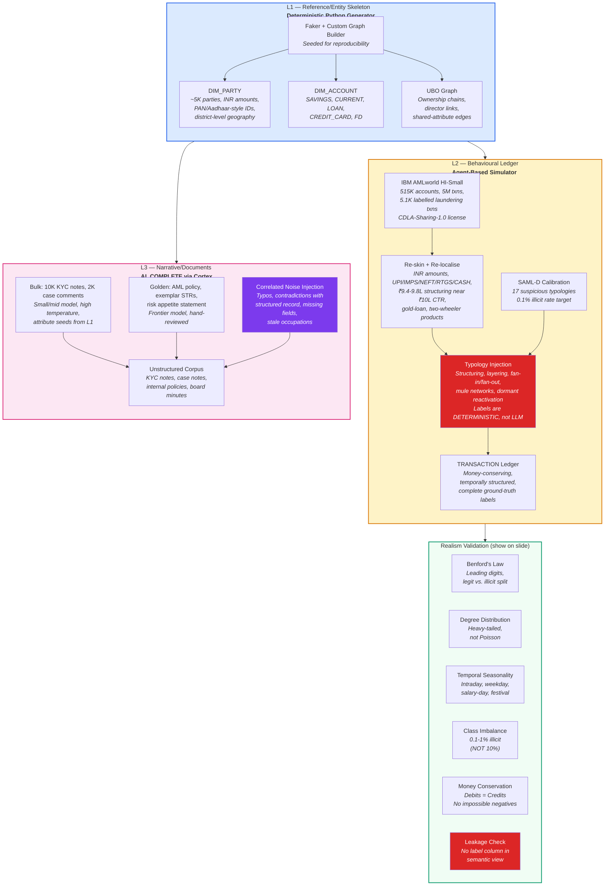

---

## 3. Data Ingestion Architecture

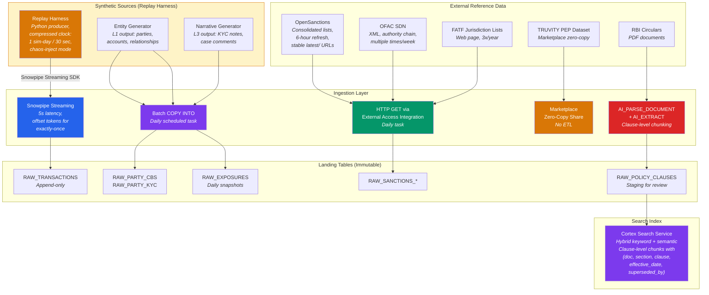

---

## 4. Transformation Pipeline — Two-Speed

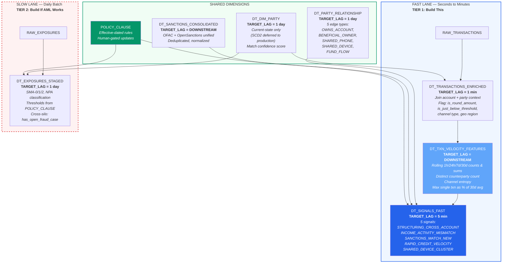

---

## 5. Cross-Domain Signal Detection

Five signals are Tier 1 in DT_SIGNALS_FAST. MULE_RING_CANDIDATE is Tier 1 but as an on-demand agent tool (recursive CTE, not incrementally refreshable). Two are Tier 2 (stretch).

```mermaid
flowchart TB
    subgraph TXN_DATA["Transaction Data"]
        VELOCITY["Velocity Features<br/><i>1h/24h/7d/30d<br/>counts, sums, ratios</i>"]
    end

    subgraph ENTITY_DATA["Entity Data"]
        KYC_D["KYC Profile<br/><i>Income, occupation,<br/>source of funds</i>"]
        GRAPH["Relationship Graph<br/><i>Shared phone/device,<br/>fund flows, ownership</i>"]
        PEP_D["PEP + Sanctions<br/><i>Watchlist matches,<br/>jurisdiction risk</i>"]
        DEVICE["Device Fingerprints<br/><i>device_fingerprint on ACCOUNT<br/>~8% shared across accounts</i>"]
    end

    subgraph CREDIT_DATA["Credit Data"]
        EXPO["Exposures<br/><i>Outstanding, DPD,<br/>SMA stage</i>"]
        CASES["Open Cases<br/><i>Fraud/AML cases<br/>on same party</i>"]
    end

    subgraph TIER1["TIER 1 — Build These (5 in DT_SIGNALS_FAST)"]
        S4["STRUCTURING_CROSS_ACCOUNT<br/><i>Sub-threshold txns split<br/>across accounts of same party<br/>vs ₹10L CTR trigger</i>"]
        S1["INCOME_ACTIVITY_MISMATCH<br/><i>30d inflows > Nx declared<br/>annual income</i>"]
        S7["SANCTIONS_MATCH_NEW<br/><i>Customer matches newly<br/>added sanctions entry<br/>via exact join on DT_SANCTIONS</i>"]
        S8["RAPID_CREDIT_VELOCITY<br/><i>N+ credits from M+ distinct<br/>remitters within D days<br/>(mule account indicator)</i>"]
        S9["SHARED_DEVICE_CLUSTER<br/><i>3+ accounts sharing<br/>device_fingerprint with<br/>fund flows between them</i>"]
    end

    subgraph TIER1_TOOL["TIER 1 — On-Demand Agent Tool (not a DT)"]
        S3["MULE_RING_CANDIDATE<br/><i>Depth-3 fund-flow cycle<br/>via recursive CTE<br/>Called by Investigator agent<br/>NOT incrementally refreshable</i>"]
    end

    subgraph TIER2["TIER 2 — Stretch Goals"]
        S6["FRAUD_BORROWER_OVERLAP<br/><i>Borrower with exposure<br/>AND fraud/AML signals</i>"]
    end

    VELOCITY --> S4
    KYC_D --> S4
    VELOCITY --> S1
    KYC_D --> S1
    PEP_D --> S7
    VELOCITY --> S8
    DEVICE --> S9
    GRAPH --> S9
    GRAPH --> S3
    EXPO --> S6
    CASES --> S6

    style TIER1 fill:#dcfce7,stroke:#16a34a,stroke-width:3px
    style TIER1_TOOL fill:#dbeafe,stroke:#2563eb,stroke-width:3px
    style TIER2 fill:#fef3c7,stroke:#d97706,stroke-width:2px,stroke-dasharray: 5 5
    style S4 fill:#16a34a,color:#fff
    style S1 fill:#16a34a,color:#fff
    style S7 fill:#16a34a,color:#fff
    style S8 fill:#16a34a,color:#fff
    style S9 fill:#16a34a,color:#fff
    style S3 fill:#2563eb,color:#fff
```

---

## 6. Signal-to-Artifact Pipeline (The Evidence Chain)

```mermaid
flowchart LR
    subgraph DETECT["1. DETECT"]
        SIG["Signal<br/><i>Rule fires on data.<br/>Persisted with ID,<br/>rule_id, as_of_ts</i>"]
    end

    subgraph GROUP["2. GROUP"]
        CASE["Case<br/><i>Groups related signals.<br/>Assigned owner, SLA clock.<br/>Status: OPEN → INVESTIGATING</i>"]
    end

    subgraph GATHER["3. GATHER"]
        EV["Evidence<br/><i>Pointers, not copies.<br/>(ref_type, ref_id,<br/>query_id, as_of_ts)<br/>RE-VERIFIABLE via<br/>Time Travel</i>"]
    end

    subgraph REASON["4. REASON"]
        FIND["Finding<br/><i>Conclusion citing<br/>evidence + policy clause.<br/>Versioned, never updated.</i>"]
    end

    subgraph DRAFT["5. DRAFT"]
        ART["Artifact<br/><i>STR narrative, LCR statement.<br/>Every numeral traced<br/>to a query result.<br/>SHA-256 content hash.</i>"]
    end

    subgraph REVIEW["6. REVIEW"]
        ADV["Adversarial Reviewer<br/><i>Does every number trace?<br/>Every assertion cite evidence?<br/>Every clause in effect?<br/>REJECT if not.</i>"]
    end

    subgraph ATTEST["7. ATTEST"]
        ATT["Attestation<br/><i>Human sign-off.<br/>Principal Officer under<br/>PML Rules Rule 7.<br/>Agent CANNOT file.</i>"]
    end

    SIG -->|"attach to"| CASE
    CASE -->|"gather for"| EV
    EV -->|"support"| FIND
    FIND -->|"produce"| ART
    ART -->|"validate"| ADV
    ADV -->|"if passed"| ATT
    ADV -->|"if failed, specific defects"| ART

    style DETECT fill:#dbeafe,stroke:#2563eb
    style GROUP fill:#e0e7ff,stroke:#4f46e5
    style GATHER fill:#d1fae5,stroke:#059669
    style REASON fill:#fef3c7,stroke:#d97706
    style DRAFT fill:#fce7f3,stroke:#db2777
    style REVIEW fill:#fee2e2,stroke:#dc2626
    style ATTEST fill:#f0fdf4,stroke:#16a34a
```

---

## 7. Single Agent Architecture — Four Modes

> **SUPERSEDED — see §S3 "Correction to Diagram 7".** Two of these four should
> not be agent modes. **Reviewer** is a stored procedure (determinism is its
> entire value; an LLM planner would undermine it, and as a procedure it runs on
> the current account today). **Sentinel** is a SQL view plus one `AI_AGG` call.
> Only **Investigator** and **Drafter** need agent-style planning. Agent
> *invocation* is trial-gated (399504) though the object deploys, so meanwhile
> the orchestration runs from Python over Cortex Analyst REST plus these same
> stored procedures — which is why the 8 tools are procedures and not Python.

A single Cortex Agent handles all four roles via system prompt mode-switching. This avoids the complexity of multi-agent orchestration while preserving the conceptual separation of concerns. The agent's system prompt defines the current mode based on the task context.

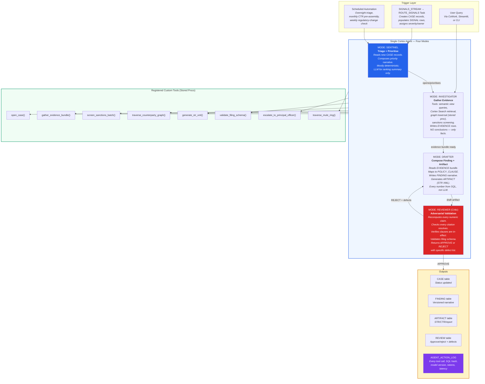

---

## 8. LLM Boundary

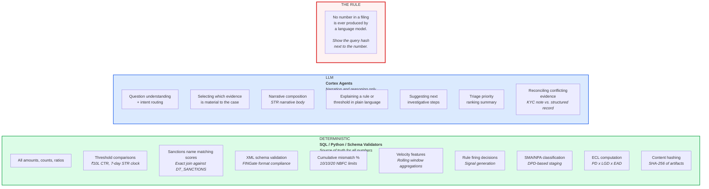

---

## 9. Notification and Case Routing

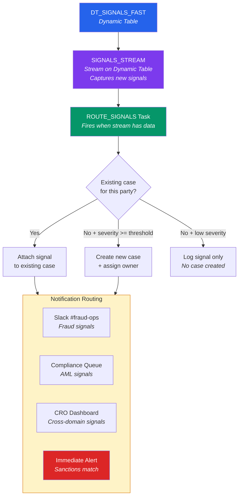

---

## 10. Policy Ingestion Pipeline

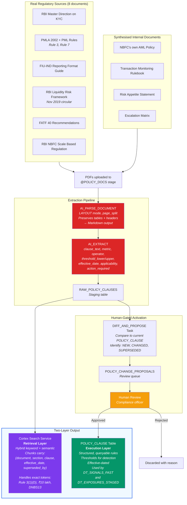

---

## 11. Governance Mechanisms

```mermaid
flowchart TB
    subgraph G1["1. Access Control (RLS + Masking)"]
        RLS["Row Access Policy<br/><i>Branch-level visibility<br/>on PARTY and TRANSACTION.<br/>Same question, two roles,<br/>different answers.</i>"]
        MASK["Masking Policy<br/><i>PAN, Aadhaar, account numbers<br/>masked for non-privileged roles.<br/>Agent cannot route around.</i>"]
    end

    subgraph G2["2. Immutable Audit Trail"]
        LOG["AGENT_ACTION_LOG<br/><i>Every turn: user, role,<br/>question, tools invoked,<br/>SQL text + hash, rows touched,<br/>model version, prompt version,<br/>evidence IDs, tokens, latency, cost.<br/>APPEND-ONLY.</i>"]
    end

    subgraph G3["3. Reproducibility"]
        REPRO["Given a finding_id:<br/><i>1. Look up evidence rows<br/>2. Get query_id and as_of_ts<br/>3. Re-run queries using<br/>   TIME TRAVEL AT(TIMESTAMP =>)<br/>4. Prove numbers match<br/>5. Demo this live on stage</i>"]
    end

    subgraph G4["4. Refusal + Confidence"]
        REFUSE["Agent refuses when:<br/><i>- No data in scope for role<br/>- Ambiguous entity resolution<br/>- Conflicting evidence<br/>- Out-of-scope question<br/>- Stale data beyond freshness gate<br/><br/>Show one deliberate refusal<br/>in the demo.</i>"]
    end

    subgraph G5["5. Maker-Checker (Filing Lifecycle)"]
        MC["DRAFT → REVIEWED → APPROVED → FILED<br/><i>Principal Officer bears<br/>filing responsibility under<br/>PML Rules Rule 7.<br/>Auto-submission is legally wrong,<br/>not just cautious.</i>"]
    end

    subgraph G6["6. Data-Quality Gates"]
        DMF["Data Metric Functions<br/><i>On every dynamic table:<br/>- Null rates<br/>- Row count vs. expected<br/>- Freshness vs. target lag<br/>- Referential integrity<br/>  (DT_ENRICHED ↔ DT_DIM_PARTY)<br/>- Volume anomaly detection<br/><br/>Agent surfaces:<br/>'This answer is based on data<br/>that is 14 hours stale'</i>"]
    end

    style G1 fill:#dbeafe,stroke:#2563eb,stroke-width:2px
    style G2 fill:#fef3c7,stroke:#d97706,stroke-width:2px
    style G3 fill:#d1fae5,stroke:#059669,stroke-width:2px
    style G4 fill:#fee2e2,stroke:#dc2626,stroke-width:2px
    style G5 fill:#fce7f3,stroke:#db2777,stroke-width:2px
    style G6 fill:#f3e8ff,stroke:#7c3aed,stroke-width:2px
    style DMF fill:#7c3aed,color:#fff
    style LOG fill:#d97706,color:#fff
```

---

## 12. Testing and Validation Framework

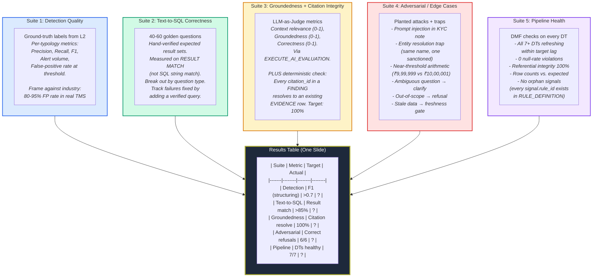

---

## 13. MCP and External Loop Closing

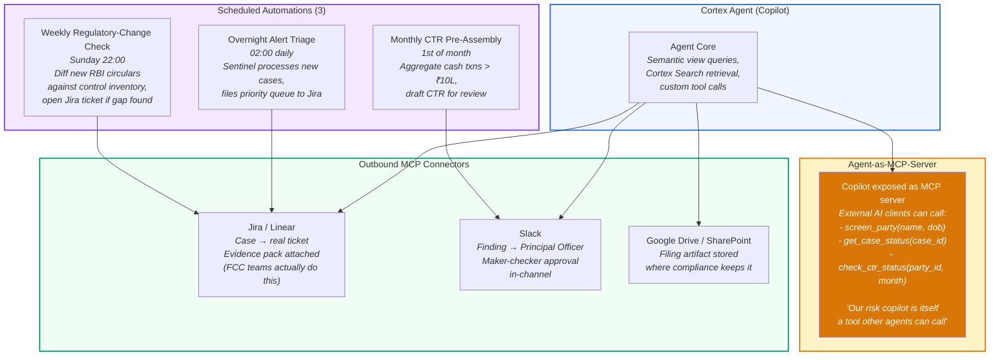

---

## 14. Demo Spine — One Entity, Four Lenses

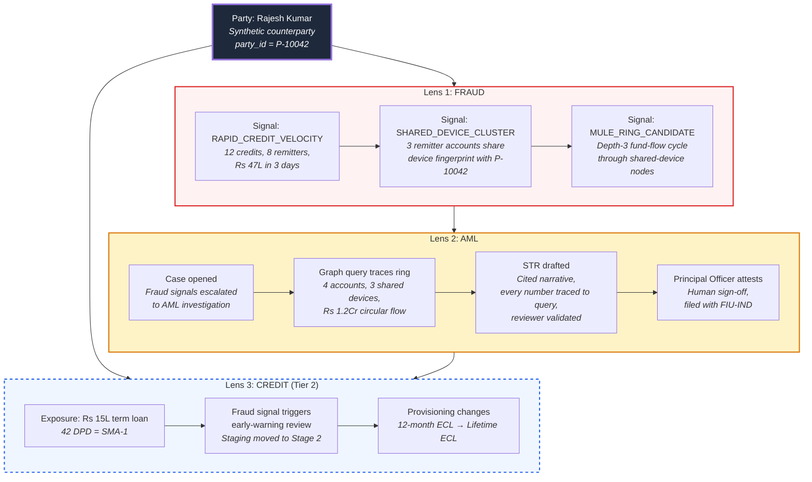

---

## 15. Complete Storage Model

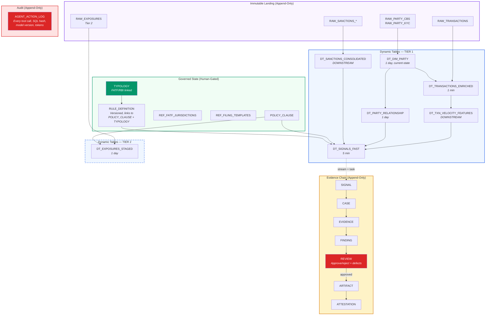

---

## 16. System Boundary

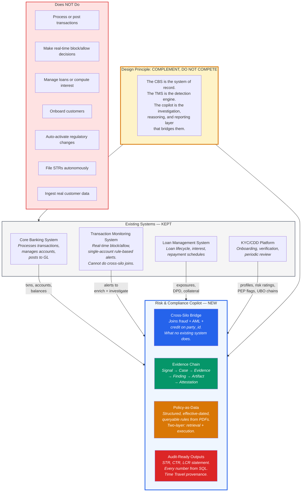

---

## 17. CoCo Lifecycle Evidence Map

```mermaid
flowchart LR
    subgraph PLAN["1. PLANNING"]
        P1["CoCo planning transcripts<br/><i>Saved as artifacts</i>"]
        P2["Data exploration outputs<br/><i>cortex search, table-details</i>"]
        P3["Ontology draft<br/><i>Plan Mode for schema design</i>"]
        P4["This design doc<br/><i>Architecture diagrams +<br/>implementation specs</i>"]
    end

    subgraph DEV["2. DEVELOPMENT"]
        D1["Git history showing<br/>CoCo-authored code:<br/><i>- Pipeline DDL<br/>- Semantic views<br/>- Agent config<br/>- Streamlit app<br/>- Stored procedures</i>"]
        D2["Model routing log<br/><i>Claude Opus for design,<br/>Sonnet for boilerplate</i>"]
    end

    subgraph EXEC["3. EXECUTION"]
        E1["Automations list<br/><i>3 scheduled AGENT TASKs<br/>with real run history</i>"]
        E2["Inspectable Cortex threads<br/><i>Open one on stage</i>"]
        E3["Cross-surface demo<br/><i>CLI → Desktop → CoWork<br/>30 seconds, big coverage</i>"]
    end

    subgraph TEST["4. TESTING"]
        T1["Evaluation runs<br/>in Snowsight<br/><i>EXECUTE_AI_EVALUATION</i>"]
        T2["Golden-question<br/>results table"]
        T3["Adversarial suite<br/>pass/fail report"]
        T4["Pipeline health<br/>DMF dashboard"]
    end

    PLAN --> DEV --> EXEC --> TEST

    style PLAN fill:#dbeafe,stroke:#2563eb,stroke-width:2px
    style DEV fill:#d1fae5,stroke:#059669,stroke-width:2px
    style EXEC fill:#fef3c7,stroke:#d97706,stroke-width:2px
    style TEST fill:#fee2e2,stroke:#dc2626,stroke-width:2px
```

---

## 18. Replay Harness Architecture

Python script using standard Snowflake Connector `INSERT INTO` in batches with `time.sleep()` to simulate real-time arrival. Snowpipe Streaming is a future scope item.

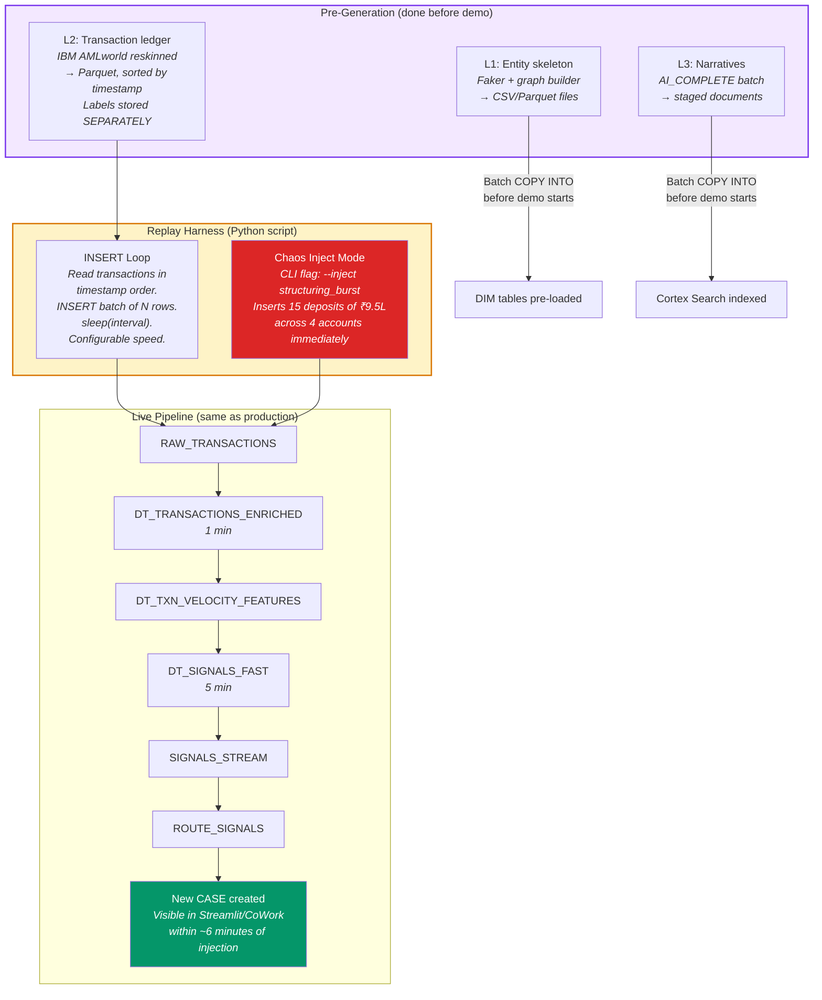

---

## Fatal Gaps Identified During This Exercise

The following are implementation-level ambiguities that would block or confuse a developer. These are not overengineering concerns — they are minimum decisions needed before writing code.

### Gap 1: Transaction Grain Conversion

IBM AMLworld ships **pair-level** (sender → receiver). The schema stores **leg-level** (one row per debit/credit side). The transformation logic needs to be specified.

**Decision needed:** During L2 reskin, each AMLworld pair row becomes two leg rows: one debit on the sender account (negative amount), one credit on the receiver account (positive amount), sharing a `txn_pair_id`. The pair-level view for graph queries is `SELECT * FROM TRANSACTION T1 JOIN TRANSACTION T2 ON T1.txn_pair_id = T2.txn_pair_id AND T1.amount < 0 AND T2.amount > 0`.

### Gap 2: SCD2 Mechanics on DIM_PARTY

**MOVED TO FUTURE SCOPE.** For the hackathon, DT_DIM_PARTY is current-state only (no effective_from/effective_to). A simple `CREATE DYNAMIC TABLE ... AS SELECT DISTINCT ... FROM RAW_PARTY_CBS` suffices. SCD2 is a demo talking point on the "What Production Would Need" slide. Evidence queries join on `party_id` without temporal filtering.

### Gap 3: Sanctions Screening Approach

**RESOLVED: Exact join only.** `DT_SIGNALS_FAST` does an exact/near-exact name join against `DT_SANCTIONS_CONSOLIDATED` for new-entry detection (SANCTIONS_MATCH_NEW: flag when a party matches a sanctions entry added since last check). The daily `CORTEX_SEARCH_BATCH` fuzzy screening approach and the `SCREENING_RESULT` table have been **dropped** to reduce complexity. For the hackathon, exact matching is sufficient. Fuzzy matching (aliases, transliterations) is a "What Production Would Need" slide item.

### Gap 4: Case Deduplication Logic

The ROUTE_SIGNALS task checks "existing case for this party?" but doesn't specify:
- What "existing" means: OPEN only? OPEN + INVESTIGATING? Include DRAFTED?
- What happens when multiple signals fire for the same party in the same 5-minute DT refresh window.
- Whether signals of different types (STRUCTURING + INCOME_MISMATCH on same party) merge into one case or create separate cases.

**Decision needed:** "Existing" = any CASE with status IN ('OPEN', 'INVESTIGATING', 'DRAFTED') for the same `party_id`. Multiple signals in the same refresh attach to the same case. Different signal types on the same party merge into one case with `case_type = 'CROSS_DOMAIN'` — this is the cross-silo story.

### Gap 5: Evidence Pointer Resolution

Evidence rows store `(ref_type, ref_id, as_of_ts)` — clean pointers to source data. Query reproducibility is handled by a separate `EVIDENCE_QUERY_LOG` table.

**RESOLVED: Separate query log table.** The `gather_evidence_bundle()` stored procedure takes a `case_id`, executes pre-defined queries (one per evidence type), and for each: (1) inserts an EVIDENCE row with the pointer (ref_type, ref_id, as_of_ts), (2) inserts an `EVIDENCE_QUERY_LOG` row with the SQL text, SHA-256 result hash, Snowflake query_id, and execution timestamp. Multiple queries can back a single evidence row. The Reviewer's `validate_finding()` proc queries `EVIDENCE_QUERY_LOG` for a given evidence_id, re-runs each `sql_text` with `AT(TIMESTAMP => as_of_ts)` via Time Travel, and compares result hashes. `RESULT_SCAN(query_id)` is **not used** — it is session-scoped and expires in 24 hours.

### Gap 6: STR XML Generation

STR XML generation must conform to FIU-IND's reporting format. The following needs to be specified:
- Where the XML template/schema definition lives.
- Whether `generate_str_xml()` is a Python UDF, a stored procedure, or an agent tool.
- How structured fields (deterministic: amounts, dates, account numbers) are separated from narrative fields (LLM: suspicion description).

**Decision needed:** `REF_FILING_TEMPLATES.field_definitions` (VARIANT column) stores the FIU-IND XML schema as a JSON spec. `generate_str_xml()` is a Python stored procedure that: (1) queries FINDING + EVIDENCE to populate structured fields via SQL, (2) takes the narrative text from FINDING.narrative as-is, (3) assembles XML using Python's `xml.etree`, (4) validates against the schema, (5) returns the XML string and a validation status. The LLM never touches the XML — it only authored the narrative that gets embedded.

### Gap 7: Verified Query Inventory

**Decision needed:** Minimum verified query set for the demo (20 queries, covering the 6-minute script):

| # | Category | Example Question |
|---|---|---|
| 1-3 | Transaction lookup | "Show all transactions for party P-10042 in the last 30 days" |
| 4-6 | Velocity | "Which accounts had more than 10 transactions in 24 hours?" |
| 7-9 | Threshold | "Which parties had total cash deposits exceeding ₹10 lakh this month?" |
| 10-12 | Network | "Who are the counterparties of account A-2051?" |
| 13-15 | Sanctions | "Is party P-10042 on any sanctions list?" |
| 16-17 | Cross-silo | "Does this party have open loans AND fraud signals?" |
| 18-19 | Case status | "How many open cases are past SLA deadline?" |
| 20 | Refusal | "What is the GDP of India?" (out-of-scope, should refuse) |

### Gap 8: Role Definitions for RLS Demo

The demo should show "the same question from two roles returning different answers." The following needs to be specified:
- What roles exist.
- What the row access policy filters on.
- Which tables have RLS applied.

**Decision needed:** Two roles: `BRANCH_ANALYST_MUMBAI` (sees only parties/transactions where `branch_region = 'MUMBAI'`) and `COMPLIANCE_OFFICER` (sees all). Row access policy on `DT_TRANSACTIONS_ENRICHED` and `DT_DIM_PARTY` filtering on `branch_region`. Masking policy on `PARTY.full_name` and any PAN/Aadhaar fields — `BRANCH_ANALYST_MUMBAI` sees masked, `COMPLIANCE_OFFICER` sees full.

### Gap 9: Replay Harness

**SIMPLIFIED.** The replay harness is a Python script using `snowflake-connector-python` that reads the pre-generated transaction Parquet/CSV in timestamp order and executes `INSERT INTO RAW_TRANSACTIONS VALUES (...)` in configurable batches with `time.sleep(interval)` between batches. No Snowpipe Streaming SDK. Chaos injection via `--inject structuring_burst` flag inserts a hardcoded burst of structuring transactions directly.

**Preflight check (before demo):** Script has a `--preflight` flag that verifies: DIM_PARTY row count > 0, Cortex Search service healthy (if available), all DTs in ACTIVE state. Dim tables and Cortex Search index loaded via a setup script (`setup_demo.sql`) that runs COPY INTO for all pre-generated data.

### Gap 10: Cortex Search Service Configuration

Cortex Search is used for regulatory text retrieval, but the following needs to be specified:
- The search service name and target table.
- Which column is the search column (clause_text? full parsed markdown?).
- The embedding model and chunk overlap settings.
- Whether the service is over RAW_POLICY_CLAUSES or a transformed table.

**Decision needed:** Service name `REGULATORY_SEARCH_SVC`. Source table: `POLICY_CLAUSE_CHUNKS` (a table derived from RAW_POLICY_CLAUSES, one row per clause). Search column: `clause_text`. Attribute columns: `source_document`, `section_heading`, `effective_from`, `effective_to`, `supersedes_clause_id`. Filter columns: `effective_to IS NULL` (only current clauses by default, but allow override for historical queries). Target lag: 1 hour.

---
---

# PART II — Build Reference

Everything below consolidates the build-ready information into one reference a developer reads sequentially before writing code.

---

## 19. Build Sequence

Order matters. Each step depends on the one above it.

| # | Step | What It Produces | Notes |
|---|---|---|---|
| 1 | Ontology + evidence-chain DDL | All tables from Diagram 1 as CREATE TABLE statements | Evidence-as-pointers is load-bearing for everything downstream |
| 2 | Document + decide synthesis approach | Written decision: IBM AMLworld reskin + Faker + AI_COMPLETE | This is a slide — record the reasoning against GAN/SMOTE |
| 3a | Calibrate parameters from public stats | Illicit rate 0.1-1%, denomination clustering, channel distribution | See Realism Validation in Diagram 2 |
| 3b | Build deterministic seeded simulator | L1 (entities) + L2 (transactions) as Parquet/CSV | Fixed RNG seed for reproducibility |
| 3c | Plant typologies + hard negatives + ground truth | `GROUND_TRUTH_LABELS` table populated | Labels are deterministic, never LLM |
| 3d | Generate unstructured layer | AI_COMPLETE for KYC notes, case comments, internal policies | Correlated noise: typos, contradictions, stale fields |
| 3e | Run realism tests as hard gate | Benford's, degree distribution, money conservation, leakage check | Must pass before proceeding |
| 4 | Semantic views + verified queries | YAML definitions + 20 verified queries | Validate against NL questions now, not at the end |
| 5 | Detection layer — rules + graph queries | 3 Tier 1 signals in DT_SIGNALS_FAST | Score against `GROUND_TRUTH_LABELS` from day one |
| 6 | Document lane — policy/circular parsing | POLICY_CLAUSE populated + Cortex Search indexed | Clause-level chunks with effective dates |
| 7 | External inputs + refresh cadence | Sanctions/PEP ingestion, FATF list, circular watcher | Each on its own clock, human-gated promotion |
| 8 | Agent chain — 4 roles | Sentinel, Investigator, Drafter, Reviewer configured | Build the Reviewer early; it changes what the Drafter must produce |
| 9 | Artifact generation + reconciliation gate + attestation | `generate_str_xml()` + `validate_filing_schema()` working | The demo climax depends on this |
| 10 | Surfaces and MCP | Streamlit app, CoWork config, Jira/Slack connectors | Last. Shallowest layer, most tempting to start with |

**Discipline:** Do not build the Streamlit app first. It is the most visible layer and the least load-bearing.

---

## 20. Target Users and What They Actually Do Today

This section exists so a developer understands *why* each component matters — not just *what* to build.

### User 1: AML Compliance Officer

**Current pain (Process A — Alert Triage):**
1. Opens TMS alert queue (40-80 alerts/day)
2. Alert shows rule name + triggering transactions. Nothing else.
3. Opens CBS (second app) → pulls 90-day transaction history
4. Opens KYC platform (third app) → pulls customer profile
5. Mentally compares ₹6.8L inward in 48 hours vs. ₹4.2L declared annual income
6. Searches each counterparty one-by-one in CBS. Manually spots shared mobile number across 3 screens.
7. Writes 2-3 line disposition. Time: 25-45 minutes per alert. Of which actual judgement: ~5 minutes. Data gathering: 20-40 minutes.

**What the copilot replaces:** Steps 3-6 (data gathering across systems). The officer asks "show me the full picture for this alert" and gets: transaction timeline, customer profile, counterparty profiles, shared attributes — in one response, every data point citing its source.

**Current pain (Process B — STR Drafting):**
1. Opens Word template. Writes narrative manually.
2. Every number manually transcribed from Excel extracts and screen captures.
3. MLRO reviews. Sends back: "total in paragraph 3 doesn't match the appendix" / "you cited the old threshold, it changed last quarter."
4. 1-3 revision cycles over 2-5 working days.
5. Filed STR saved as disconnected PDF. Link to source data: the officer's memory.

**What the copilot replaces:** Drafting (numbers embedded with provenance, not transcribed), revision cycles (MLRO clicks any number → sees the query that produced it, re-executable via Time Travel), and the disconnected PDF (artifact with immutable evidence links).

**What the copilot does NOT replace:** The MLRO's sign-off. Legally required human judgement with personal liability.

### User 2: Fraud Operations Analyst

200-500 alerts/day. 90-98% false positive rate. SLA: 30 minutes per alert.

**Critical gap the copilot fills:** After finding 3 suspect counterparty accounts, the analyst cannot check if they share phone/address/IP/device. That data lives in a separate onboarding system. The graph query over `PARTY_RELATIONSHIP` surfaces shared attributes instantly.

### User 3: Credit Risk Analyst

**Cross-silo join (the differentiator):** Credit analyst asks about an SMA-2 account. The copilot surfaces: this borrower also has an open fraud case AND an AML alert. Today, the credit analyst would never know this. Nobody joins these systems.

### User 4: Treasury / ALM Officer

LCR computation and structural liquidity statement. Tier 2 scope — build only if AML spine works. The regulatory haircuts and run-off rates live in `POLICY_CLAUSE` with effective dates.

---

## 21. PS Requirements Traceability

Every component maps to a specific PS requirement. A developer should know which requirement they're satisfying.

| Req | PS Text | What Satisfies It |
|---|---|---|
| R1 | "Combine transaction and account data with policy and filing text" | Semantic view joining DT_TRANSACTIONS_ENRICHED + DT_DIM_PARTY + POLICY_CLAUSE + Cortex Search |
| R2 | "Let a business or compliance user ask questions" | Cortex Agent with verified queries — NL interface for non-technical users |
| R3 | "Governed, explainable, evidence-backed answers" | Every answer cites query_id + source rows + as_of_ts + policy clause. LLM boundary (Diagram 8). RLS + masking (Diagram 11). |
| R4 | "Cover the flow from signal to evidence to documented finding or report" | Signal → Case → Evidence → Finding → Artifact → Attestation (Diagram 6). All persisted objects with IDs. |
| R5 | "Audit-ready regulatory outputs" | STR XML with numeric reconciliation gate. Every number from SQL, never LLM. Content hash. Time Travel reproducibility. |

---

## 22. Category C Decisions (Internal, No Research Needed)

These must be written down before the first DDL statement.

### Database and Schema Naming

```
RISK_COPILOT                    -- database
  ├── RAW                       -- landing tables (immutable)
  ├── CURATED                   -- dynamic tables, dimension tables
  ├── GOVERNANCE                -- POLICY_CLAUSE, TYPOLOGY, RULE_DEFINITION, REF_*
  ├── EVIDENCE_CHAIN            -- SIGNAL, CASE, EVIDENCE, FINDING, REVIEW, ARTIFACT, ATTESTATION
  ├── AUDIT                     -- AGENT_ACTION_LOG
  └── GROUND_TRUTH              -- labels, evaluation datasets (NOT in semantic view)
```

### Warehouse Sizing

| Warehouse | Size | Purpose |
|---|---|---|
| `RC_DEV_WH` | X-Small | Development, DDL, ad-hoc queries |
| `RC_PIPELINE_WH` | Small | Dynamic table refresh, scheduled tasks |
| `RC_DEMO_WH` | Small | Demo queries, agent execution |

### Role Hierarchy

```
ACCOUNTADMIN
  └── RC_ADMIN                  -- owns all objects, creates roles
        ├── COMPLIANCE_OFFICER  -- sees all data, can attest artifacts
        ├── BRANCH_ANALYST_MUMBAI  -- RLS: branch_region = 'MUMBAI'
        ├── BRANCH_ANALYST_DELHI   -- RLS: branch_region = 'DELHI'
        └── RC_SERVICE_ROLE     -- used by agents and automations
```

Row access policy on: `DT_TRANSACTIONS_ENRICHED`, `DT_DIM_PARTY` — filters on `branch_region`.
Masking policy on: `PARTY.full_name`, PAN/Aadhaar fields — `BRANCH_ANALYST_*` sees masked.

### Cortex Model Assignment per Agent Role

| Agent Role | Model | Why |
|---|---|---|
| Sentinel | `llama3.1-8b` | Cheap, mostly deterministic triage |
| Investigator | `claude-3.5-sonnet` | Strong tool use for evidence gathering |
| Drafter | `claude-3.5-sonnet` | Narrative quality for STR drafting |
| Reviewer | `llama3.1-70b` | Checklist execution, cheaper for validation loops |
| Bulk narrative gen (L3) | `llama3.1-8b` | High volume, low cost |
| Golden document gen (L3) | `claude-3.5-sonnet` | Quality, hand-reviewed |

### Ground Truth Table

```sql
CREATE TABLE GROUND_TRUTH.LABELS (
    txn_id          STRING,
    typology_id     STRING,     -- FK to GOVERNANCE.TYPOLOGY
    is_illicit      BOOLEAN,
    injection_method STRING,    -- 'amlworld_original' | 'reskin_structuring' | 'reskin_layering'
    inserted_at     TIMESTAMP DEFAULT CURRENT_TIMESTAMP()
);
```

This table is NEVER exposed in the semantic view. Leakage check (Realism Validation V6) confirms this.

---

## 23. Verified Query Inventory (Minimum 20)

These are authored as verified queries in the semantic view YAML. They cover the 6-minute demo script.

| # | Category | Question | Expected Behaviour |
|---|---|---|---|
| 1 | Txn lookup | "Show all transactions for party P-10042 in the last 30 days" | Returns transaction list with amounts, channels, counterparties |
| 2 | Txn lookup | "What is the total inflow for account A-2051 this month?" | Returns single number from SUM(amount) WHERE amount > 0 |
| 3 | Txn lookup | "List the top 10 accounts by transaction volume in the last 7 days" | Ranked list |
| 4 | Velocity | "Which accounts had more than 10 transactions in 24 hours?" | Uses DT_TXN_VELOCITY_FEATURES |
| 5 | Velocity | "Show accounts with the highest channel entropy" | Entropy from velocity features |
| 6 | Velocity | "Which accounts had a single transaction exceeding 50% of their 30-day average?" | Max-single-txn ratio |
| 7 | Threshold / CTR | "Which parties had total cash deposits exceeding ₹10 lakh this month?" | CTR candidate list — the core regulatory question |
| 8 | Threshold / CTR | "How many cash transactions were between ₹9 lakh and ₹10 lakh this month?" | Structuring indicator |
| 9 | Threshold | "List all parties whose 30-day inflows exceed 3x their declared annual income" | INCOME_ACTIVITY_MISMATCH signal |
| 10 | Network | "Who are the counterparties of account A-2051?" | Uses PARTY_RELATIONSHIP (FUND_FLOW edges) |
| 11 | Network | "Which accounts share a phone number or device with party P-10042?" | SHARED_PHONE / SHARED_DEVICE edges |
| 12 | Network | "Show all fund flow connections within 2 hops of party P-10042" | Graph traversal |
| 13 | Sanctions | "Is party P-10042 on any sanctions list?" | Joins DT_DIM_PARTY to DT_SANCTIONS_CONSOLIDATED |
| 14 | Sanctions | "Which parties match entries added to OFAC in the last 7 days?" | SANCTIONS_MATCH_NEW signal |
| 15 | Sanctions | "How many parties are flagged as PEP?" | Count from DT_DIM_PARTY WHERE pep_flag = TRUE |
| 16 | Cross-silo | "Does party P-10042 have any open loans AND fraud/AML signals?" | Joins CASE + EXPOSURE — the cross-silo story |
| 17 | Cross-silo | "List all parties with both SMA-2 exposure and open AML cases" | FRAUD_BORROWER_OVERLAP |
| 18 | Case status | "How many open cases are past their SLA deadline?" | CASE WHERE status IN ('OPEN','INVESTIGATING') AND sla_deadline < CURRENT_TIMESTAMP() |
| 19 | Case status | "Show the evidence bundle for case C-0087" | Returns EVIDENCE rows with ref_type, ref_id, as_of_ts |
| 20 | Refusal | "What is the GDP of India?" | Out-of-scope. Agent should refuse with explanation. |

---

## 24. STR Filing Schema (Validated Against FIU-IND SBA01–SBA04)

**Source:** `data/FIU-IND_STR_Banking_Company_SBA.md` — actual FIU-IND STR form for banking companies. Legal basis: PMLA 2002.

The `generate_str_xml()` stored procedure outputs an 8-Part structure matching the official form. Annexures A/B/C are omitted for hackathon — noted on demo slide as a production requirement.

### Part 1 — Details of Report

| Field | Source | Deterministic? |
|---|---|---|
| `report_date` | CURRENT_DATE() | Yes |
| `is_replacement` | FALSE (hardcoded) | Yes |
| `original_report_date` | NULL | Yes |

### Part 2 — Details of Principal Officer

| Field | Source | Deterministic? |
|---|---|---|
| `bank_name` | Hardcoded: fictional NBFC name | Yes |
| `bsr_code` | Hardcoded | Yes |
| `fiu_ind_id` | Hardcoded or blank (per FIU-IND instruction) | Yes |
| `bank_category` | Hardcoded: one of A–F/Z (see form codes) | Yes |
| `principal_officer_name` | From ATTESTATION.attestor | Yes |
| `principal_officer_designation` | Hardcoded | Yes |
| `po_address` | Hardcoded (full: building, street, locality, city, state, pin, tel, fax, email) | Yes |

### Part 3 — Details of Reporting Branch / Location

| Field | Source | Deterministic? |
|---|---|---|
| `branch_name` | Hardcoded: fictional branch | Yes |
| `branch_bsr_code` | Hardcoded | Yes |
| `branch_fiu_ind_id` | Hardcoded or blank | Yes |
| `branch_address` | Hardcoded (full address block) | Yes |

### Part 4 — List of Individuals Linked to Transactions

| Field | Source | Deterministic? |
|---|---|---|
| `individuals[]` (up to 15 rows) | PARTY records linked to CASE via EVIDENCE WHERE party_type = 'Individual' | Yes |
| `individuals[].name` | DT_DIM_PARTY.full_name (as-of alert time) | Yes |
| `individuals[].customer_id` | PARTY.party_id | Yes |

**Annexure A (per individual) — SKIPPED for hackathon.** Would contain: ID proof type/number, DOB, father's/spouse's name, address, occupation, nationality. All available from DT_DIM_PARTY but not assembled into sub-documents.

### Part 5 — List of Legal Persons/Entities Linked to Transactions

| Field | Source | Deterministic? |
|---|---|---|
| `entities[]` (up to 10 rows) | PARTY records WHERE party_type IN ('Corporation', 'Partnership', 'Sole Proprietorship') linked to CASE | Yes |
| `entities[].name` | DT_DIM_PARTY.full_name | Yes |
| `entities[].customer_id` | PARTY.party_id | Yes |

**Annexure B (per entity) — SKIPPED for hackathon.**

### Part 6 — List of Accounts Linked to Transactions

| Field | Source | Deterministic? |
|---|---|---|
| `accounts[]` (up to 10 rows) | ACCOUNT records from EVIDENCE WHERE ref_type = 'ACCOUNT' | Yes |
| `accounts[].account_number` | ACCOUNT.account_id | Yes |
| `accounts[].first_holder_name` | Join ACCOUNT → PARTY | Yes |

**Annexure C (per account) — SKIPPED for hackathon.**

### Part 7 — Details of Suspicious Transaction

| Field | Source | Deterministic? |
|---|---|---|
| `reason_codes[]` | Mapped from TYPOLOGY — see mapping table below | Yes |
| `grounds_of_suspicion` | FINDING.narrative (composed by Drafter agent) | **No — LLM** |

**Reason code mapping (FIU-IND codes A–F, Z):**

| Our Typology | FIU-IND Code | Reason |
|---|---|---|
| STRUCTURING_CROSS_ACCOUNT | F + D | Value of transactions + Activity in accounts |
| INCOME_ACTIVITY_MISMATCH | D + F | Activity in accounts + Value of transactions |
| SANCTIONS_MATCH_NEW | A + B | Identity of client + Background of client |
| MULE_RING_CANDIDATE | C + E | Multiple accounts + Nature of transactions |

**Supplementary data (embedded in grounds or as appendix):**

| Field | Source | Deterministic? |
|---|---|---|
| `transaction_count` | COUNT from EVIDENCE WHERE ref_type = 'TRANSACTION' | Yes |
| `total_amount` | SUM(amount) from evidenced transactions | Yes |
| `currency` | 'INR' | Yes |
| `date_range_from` / `date_range_to` | MIN/MAX(txn_timestamp) from evidenced transactions | Yes |
| `channels_used` | ARRAY_AGG(DISTINCT channel) | Yes |
| `typology_reference` | TYPOLOGY.fatf_reference (via RULE_DEFINITION) | Yes |
| `rule_ids_triggered` | SIGNAL.rule_id (internal audit trail, not filed) | Yes |
| `policy_clauses_cited` | FINDING.cited_clause_ids (internal, not filed) | Yes |

### Part 8 — Details of Action Taken

| Field | Source | Deterministic? |
|---|---|---|
| `action_description` | Template: "Account placed under enhanced monitoring" | Yes (template) |
| `investigation_agency` | Hardcoded or NULL (no external referral in demo) | Yes |
| `case_id` | CASE.case_id (internal reference) | Yes |

### Signature Block

| Field | Source | Deterministic? |
|---|---|---|
| `signatory_name` | Must match Part 2 principal_officer_name | Yes |
| `signature_date` | CURRENT_DATE() | Yes |

### Design Rules

- Every field except `grounds_of_suspicion` (Part 7) is populated by SQL. The LLM authored the narrative which is embedded as-is.
- The Reviewer validates that numeric claims in the narrative match the supplementary data.
- `generate_str_xml()` is a Python stored procedure using `xml.etree.ElementTree`.
- Content hash (SHA-256) stored in ARTIFACT.content_hash for tamper detection.
- **Demo slide caveat:** *"STR output structured to FIU-IND SBA01–SBA04 8-Part layout. Annexures A/B/C omitted for prototype. Production would generate full annexures and integrate with FINGate portal."*

---

## 25. Pre-Build Research Checklist

Items that require looking something up externally before code can be written. Answers should be appended directly to the relevant section of this document.

| # | Item | Time | Status | Findings |
|---|---|---|---|---|
| B1 | IBM AMLworld HI-Small: download, inspect schema, document columns and types | 30 min | **DONE** | See Section 25.1 below |
| B2 | OFAC SDN XML: verify URL, document XML tag paths for XMLGET/FLATTEN | 20 min | **DONE** | See `data/ofac-sdn-schema.md` + Section 25.2 below |
| B3 | OpenSanctions: verify `latest/` URL, format (JSON/CSV/FtM), column list | 15 min | **DONE** | See Section 25.3 below |
| B4 | STR filing schema: validate Section 24 above against any publicly available FIU-IND field descriptions | 45 min | **DONE** | See Section 25.4 below |
| B5 | Snowflake environment: which account, which region, are AI functions / Snowpipe Streaming / Cortex Agents / Cortex Search enabled? | 15 min | **TODO — MUST RESOLVE BEFORE DEV START** | Partial: account `ND28304`, region `AWS_AP_SOUTH_1`, role `ACCOUNTADMIN`, warehouse `COMPUTE_WH` (XS, Gen2). **BLOCKERS remaining:** (1) List available CORTEX.COMPLETE models — Section 22 model assignments (`claude-3.5-sonnet`, `llama3.1-8b/70b`) are unverified and likely wrong for this region. (2) Verify Cortex Agents availability (`SHOW CORTEX AGENTS`). (3) Verify Cortex Search availability (`SHOW CORTEX SEARCH SERVICES`). (4) Verify AI functions: `AI_COMPLETE`, `AI_PARSE_DOCUMENT`, `AI_EXTRACT`, `CORTEX_SEARCH_BATCH`, `EXECUTE_AI_EVALUATION`. (5) Check Snowflake edition for Time Travel retention limits. **Do not start agent development (Build Step 8) until model names are confirmed and Section 22 is updated.** |
| B6 | MCP servers: which connectors available in hackathon environment (Jira / Slack / Drive)? Fallback plan if none. | 10 min | **DONE** | See Section 25.6 below |

### 25.1 B1 Findings — IBM AMLworld HI-Small

**Source:** Kaggle, IBM AMLworld HI-Small dataset (CDLA-Sharing-1.0 license). 3 files downloaded to `data/Kaggle/`.

#### Files & Stats

| File | Rows | Size | Notes |
|---|---|---|---|
| `HI-Small_Trans.csv` | 5,078,345 | 454 MB | Transaction ledger, 11 columns |
| `HI-Small_accounts.csv` | 518,581 | 32 MB | Account-to-entity mapping, 5 columns |
| `HI-Small_Patterns.txt` | 370 attempts, 3,209 illicit txns | 316 KB | Ground-truth labels with typology annotations |

#### Transaction CSV Schema (HI-Small_Trans.csv)

| # | Header (as-is) | Meaning | Snowflake Type | Maps To (Architecture) |
|---|---|---|---|---|
| 1 | `Timestamp` | Txn datetime, format `YYYY/MM/DD HH:MI` | `TIMESTAMP_NTZ` | `TRANSACTION.txn_timestamp` |
| 2 | `From Bank` | Originator bank ID | `VARCHAR` | Join to `ACCOUNT` via composite key |
| 3 | `Account` (1st) | Originator account hex ID | `VARCHAR` | `TRANSACTION.account_id` (debit leg) |
| 4 | `To Bank` | Beneficiary bank ID | `VARCHAR` | Join to `ACCOUNT` via composite key |
| 5 | `Account` (2nd) | Beneficiary account hex ID | `VARCHAR` | `TRANSACTION.counterparty_account_id` |
| 6 | `Amount Received` | Amount credited to beneficiary | `NUMBER(18,2)` | `TRANSACTION.amount` (credit side) |
| 7 | `Receiving Currency` | Currency of received amount | `VARCHAR` | `TRANSACTION.currency` |
| 8 | `Amount Paid` | Amount debited from originator | `NUMBER(18,2)` | `TRANSACTION.amount` (debit side) |
| 9 | `Payment Currency` | Currency of paid amount | `VARCHAR` | Source currency (for FX pairs) |
| 10 | `Payment Format` | Channel type | `VARCHAR` | `TRANSACTION.channel` |
| 11 | `Is Laundering` | Ground-truth label (0/1) | `INT` | **NEVER in semantic view** — label column for eval only |

**Critical CSV issue:** Columns 3 and 5 both have header `Account`. Standard CSV parsers will error or deduplicate. During COPY INTO, use positional column references (`$1` through `$11`) and assign explicit names.

#### Accounts CSV Schema (HI-Small_accounts.csv)

| # | Header | Meaning | Snowflake Type | Maps To (Architecture) |
|---|---|---|---|---|
| 1 | `Bank Name` | Human-readable bank name | `VARCHAR` | Dimension attribute |
| 2 | `Bank ID` | Numeric bank identifier | `VARCHAR` | Composite FK with Account Number |
| 3 | `Account Number` | Hex account identifier | `VARCHAR` | `ACCOUNT.account_id` |
| 4 | `Entity ID` | Hex entity/party identifier | `VARCHAR` | `PARTY.party_id` |
| 5 | `Entity Name` | Entity type + number | `VARCHAR` | `PARTY.full_name` / `party_type` derivable (Corporation, Partnership, Sole Proprietorship, Individual, Country) |

#### Patterns File Structure (HI-Small_Patterns.txt)

Not CSV. Structured as blocks delimited by `BEGIN LAUNDERING ATTEMPT - {TYPE}` / `END LAUNDERING ATTEMPT - {TYPE}`. Between delimiters: transaction rows in same CSV format as `HI-Small_Trans.csv` with `Is Laundering = 1`.

**Typology distribution (370 attempts):**

| Typology | Count | Architecture Mapping |
|---|---|---|
| CYCLE | 54 | Layering — funds return to origin via N hops |
| GATHER-SCATTER | 51 | Fan-in then fan-out — classic mule aggregation |
| BIPARTITE | 49 | Two disjoint groups with cross-flows |
| FAN-OUT | 48 | Single source distributes to many destinations |
| SCATTER-GATHER | 44 | Fan-out then consolidation |
| STACK | 43 | Parallel independent 2-hop chains |
| RANDOM | 41 | Variable-hop chains, no fixed topology |
| FAN-IN | 40 | Many sources to single destination |

#### Key Metrics for Realism Validation

- **Illicit rate:** ~~3,209 / 5,078,345 = 0.063% — within the 0.1% target band~~ **Superseded (§S4, M5):** 5,177 / 5,078,345 = **0.102%**; 3,209 of those are attributed to attempts, 1,968 are not
- **Currencies:** US Dollar (dominant), Euro, Yuan, Rupee, UK Pound, Australian Dollar, Canadian Dollar, Swiss Franc, Yen, Mexican Peso, Ruble, Saudi Riyal, Shekel, Brazil Real
- **Payment formats:** Reinvestment, Credit Card, ACH, Cheque, Cash, Wire
- **Date range:** 2022-09-01 .. 2022-09-18, but **legitimate activity ends on 09-10** (99.98% of pairs; §S4, M21)

#### Re-skinning Required for Indian Context

| Original | Target | Transform |
|---|---|---|
| USD amounts | INR amounts | Multiply by ~83 (exchange rate); calibrate structuring threshold to ₹10,00,000 (₹10L CTR) |
| ACH, Wire, Cheque, etc. | UPI, IMPS, NEFT, RTGS, CASH | Map: ACH→NEFT, Wire→RTGS, Cheque→Cheque, Cash→CASH, Credit Card→UPI, Reinvestment→IMPS |
| US Dollar, Euro, etc. | INR (primary) + some forex | Majority → INR; keep ~5% as USD/EUR for cross-border signals |
| Hex account IDs | Indian-style IDs | Prefix with branch codes, or keep hex (synthetic anyway) |
| Entity Name patterns | Indian names | Use Faker `en_IN` locale for L1 party generation (`hi_IN` produces Devanagari — §S4, M20) |

#### Staging Table DDL (to be created during build)

```sql
-- Positional load to avoid duplicate-header problem
CREATE OR REPLACE TABLE RAW_TRANSACTIONS (
    txn_timestamp       TIMESTAMP_NTZ,
    from_bank           VARCHAR,
    from_account        VARCHAR,
    to_bank             VARCHAR,
    to_account          VARCHAR,
    amount_received     NUMBER(18,2),
    receiving_currency  VARCHAR,
    amount_paid         NUMBER(18,2),
    payment_currency    VARCHAR,
    payment_format      VARCHAR,
    is_laundering       INT           -- ground truth, NEVER expose in semantic view
);

CREATE OR REPLACE TABLE RAW_ACCOUNTS (
    bank_name       VARCHAR,
    bank_id         VARCHAR,
    account_number  VARCHAR,
    entity_id       VARCHAR,
    entity_name     VARCHAR
);

-- Patterns parsed separately for evaluation ground truth
CREATE OR REPLACE TABLE RAW_LAUNDERING_PATTERNS (
    attempt_id      INT AUTOINCREMENT,
    typology        VARCHAR,    -- CYCLE, FAN-OUT, GATHER-SCATTER, etc.
    max_detail      VARCHAR,    -- "Max 10 hops", "Max 16-degree Fan-Out", etc.
    txn_data        VARIANT     -- Array of transaction rows in this attempt
);
```

#### COPY INTO Approach

```sql
-- Transactions: use positional references to handle duplicate "Account" header
COPY INTO RAW_TRANSACTIONS
FROM @DATA_STAGE/Kaggle/HI-Small_Trans.csv
FILE_FORMAT = (TYPE = 'CSV' SKIP_HEADER = 1 FIELD_OPTIONALLY_ENCLOSED_BY = '"')
ON_ERROR = 'CONTINUE';

-- Accounts: standard header-based load works fine
COPY INTO RAW_ACCOUNTS
FROM @DATA_STAGE/Kaggle/HI-Small_accounts.csv
FILE_FORMAT = (TYPE = 'CSV' SKIP_HEADER = 1 FIELD_OPTIONALLY_ENCLOSED_BY = '"')
ON_ERROR = 'CONTINUE';
```

---

### 25.2 B2 Findings — OFAC SDN XML

**Status:** Full schema reference documented in `data/ofac-sdn-schema.md`.

**Key takeaways for build:**
- Source URL: `https://www.treasury.gov/ofac/downloads/sdn.xml` (redirects, updated in-place)
- Extraction uses `XMLGET` + `FLATTEN` — all paths documented in the schema ref
- Normalized to: `sdn_entry`, `sdn_program`, `sdn_alias`, `sdn_address`, `sdn_nationality`, `sdn_citizenship`, `sdn_birth_date`, `sdn_birth_place`, `sdn_identifier`
- Maps to architecture's `SANCTIONS_ENTRY` table and feeds `DT_SANCTIONS_CONSOLIDATED`
- Ingestion method: External Access Integration → HTTP GET (daily scheduled task) → XML parse → staging tables
- `Publish_Date` and `Record_Count` serve as ingestion metadata for provenance

---

### 25.3 B3 Findings — OpenSanctions

**Source:** OpenSanctions consolidated `sanctions` dataset (not `default` — sanctions-only subset).
- Artifact URL used: `https://data.opensanctions.org/artifacts/sanctions/20260921074701-lbd/`
- License: OpenSanctions License (free for non-commercial; hackathon qualifies)

#### Files Downloaded to `data/`

| File | Rows | Size | Format | Use |
|---|---|---|---|---|
| `targets.simple.csv` | 80,835 sanctioned targets | 70 MB | Flat CSV, semicolon-delimited multi-values within fields | **Primary — use this for ingestion** |
| `entities.ftm.json` | All entities (targets + non-targets like addresses, ownerships) | 348 MB | NDJSON (one FtM JSON object per line) | Reference only — too complex for hackathon scope |

#### Decision: Use `targets.simple.csv`, skip `entities.ftm.json`

The FtM JSON is richer (nested properties, relationship entities, referent chains) but massively over-scoped for a hackathon. The flat CSV has everything we need for sanctions screening: names, aliases, birth dates, countries, identifiers, and program IDs. The architecture's `SANCTIONS_ENTRY` table and `CORTEX_SEARCH_BATCH` screening only need name + aliases + country + list source.

#### targets.simple.csv Schema

| # | Column | Example | Snowflake Type | Maps To (Architecture) |
|---|---|---|---|---|
| 1 | `id` | `NK-223BSVnvKHYB96adihNXXZ` | `VARCHAR` | `SANCTIONS_ENTRY.entry_id` |
| 2 | `schema` | `Person`, `Organization`, `Company`, `Vessel`, `LegalEntity` | `VARCHAR` | Entity type filter |
| 3 | `name` | `Michael Kuajien` | `VARCHAR` | `SANCTIONS_ENTRY.entity_name` |
| 4 | `aliases` | Semicolon-delimited: `KUAJIEN, Michael;Michael Kuajian` | `VARCHAR` | `SANCTIONS_ENTRY.aliases` (parse to ARRAY) |
| 5 | `birth_date` | `1979-01-01` or `1990-03` (partial dates exist) | `VARCHAR` | Date of birth (keep as VARCHAR, partial dates) |
| 6 | `countries` | Semicolon-delimited ISO2: `ke;ss` | `VARCHAR` | `SANCTIONS_ENTRY.nationality` |
| 7 | `addresses` | Semicolon-delimited | `VARCHAR` | Address context for screening |
| 8 | `identifiers` | Semicolon-delimited: reg numbers, tax IDs, IMO numbers | `VARCHAR` | Cross-reference IDs |
| 9 | `sanctions` | Semicolon-delimited: program descriptions + dates | `VARCHAR` | Sanctions detail / `SANCTIONS_ENTRY.program` |
| 10 | `phones` | Semicolon-delimited | `VARCHAR` | Contact info |
| 11 | `emails` | Semicolon-delimited | `VARCHAR` | Contact info |
| 12 | `program_ids` | Semicolon-delimited: `US-GLOMAG;EU-UKR` | `VARCHAR` | `SANCTIONS_ENTRY.list_source` (parse to ARRAY) |
| 13 | `dataset` | Semicolon-delimited: source list names | `VARCHAR` | Provenance |
| 14 | `first_seen` | `2023-04-20T10:27:20` | `TIMESTAMP_NTZ` | Tracking |
| 15 | `last_seen` | `2026-09-21T06:56:20` | `TIMESTAMP_NTZ` | Tracking / freshness |
| 16 | `last_change` | `2026-01-26T16:10:01` | `TIMESTAMP_NTZ` | Change detection |

#### Multi-value field handling

Fields like `aliases`, `countries`, `identifiers`, `program_ids` use `;` as a delimiter within the CSV cell. During load, parse these into Snowflake `ARRAY` using `SPLIT(col, ';')` for use with `CORTEX_SEARCH_BATCH` and for building the `SANCTIONS_ENTRY.aliases` VARIANT column.

#### Entity type distribution (approximate from sample)

The `schema` column has: `Person`, `Organization`, `Company`, `LegalEntity`, `Vessel`. For AML screening, `Person` and `Organization`/`Company` are the primary targets. `Vessel` is out of scope.

#### Staging Table DDL (to be created during build)

```sql
CREATE OR REPLACE TABLE RAW_SANCTIONS_OPENSANCTIONS (
    id              VARCHAR,
    schema          VARCHAR,        -- Person, Organization, Company, Vessel, LegalEntity
    name            VARCHAR,
    aliases         VARCHAR,        -- semicolon-delimited; parse with SPLIT(aliases, ';')
    birth_date      VARCHAR,        -- partial dates exist (e.g. '1990-03')
    countries       VARCHAR,        -- semicolon-delimited ISO2 codes
    addresses       VARCHAR,
    identifiers     VARCHAR,        -- semicolon-delimited
    sanctions       VARCHAR,
    phones          VARCHAR,
    emails          VARCHAR,
    program_ids     VARCHAR,        -- semicolon-delimited (US-GLOMAG, EU-UKR, etc.)
    dataset         VARCHAR,        -- source list names
    first_seen      TIMESTAMP_NTZ,
    last_seen       TIMESTAMP_NTZ,
    last_change     TIMESTAMP_NTZ
);
```

#### COPY INTO Approach

```sql
COPY INTO RAW_SANCTIONS_OPENSANCTIONS
FROM @DATA_STAGE/targets.simple.csv
FILE_FORMAT = (TYPE = 'CSV' SKIP_HEADER = 1 FIELD_OPTIONALLY_ENCLOSED_BY = '"'
               ESCAPE_UNENCLOSED_FIELD = NONE)
ON_ERROR = 'CONTINUE';
```

#### Relationship to OFAC SDN (B2)

OpenSanctions **consolidates** OFAC SDN along with 40+ other lists (EU, UK FCDO, Canadian SEMA, Swiss SECO, etc.). For the hackathon:
- **Use OpenSanctions as the primary screening source** — it already includes OFAC entries
- **Keep OFAC SDN XML ingestion as a separate demo** — shows Snowflake XML parsing capability (XMLGET/FLATTEN), which is a distinct technical showcase
- `DT_SANCTIONS_CONSOLIDATED` should UNION both sources, deduplicated by name + list source

#### Hackathon Ingestion Path (What We Build)

Manual upload → COPY INTO. No automation.

1. Upload `targets.simple.csv` to an internal stage via `PUT` (SnowSQL / Snowsight / CoCo)
2. `COPY INTO RAW_SANCTIONS_OPENSANCTIONS` from the stage
3. Done

#### Future Extension Scope (PPT Slide Only — Not Built)

The following pipeline would automate sanctions list refresh in production. **List on the "What Production Would Need" slide, do not implement.**

1. **Network Rule** — whitelists outbound HTTPS to `data.opensanctions.org`
2. **External Access Integration** — references the network rule, attached to a stored procedure
3. **Python Stored Procedure** — uses `requests` via the External Access Integration to fetch `https://data.opensanctions.org/datasets/latest/sanctions/targets.simple.csv` (~70 MB, refreshed every ~6 hours), writes to internal stage
4. **Scheduled Task** — triggers the procedure daily, followed by `COPY INTO` + dedup merge into `DT_SANCTIONS_CONSOLIDATED`

Same pattern applies to OFAC SDN XML refresh (B2) — manual upload for hackathon, External Access Integration pipeline for the future extension slide.

#### OpenSanctions API — Not Needed

The API (paid, requires API key) adds entity resolution and fuzzy matching — but `CORTEX_SEARCH_BATCH` inside Snowflake replaces that value proposition entirely. Not a hackathon item, not a future extension item.

---

### 25.4 B4 Findings — STR Filing Schema Validation

**Task:** Validate Section 24's approximated STR schema against the actual FIU-IND STR form for banking companies (form code SBA01–SBA04).

**Source:** `data/FIU-IND_STR_Banking_Company_SBA.md` — text conversion of the official FIU-IND STR PDF. Legal basis: PMLA 2002.

#### Actual FIU-IND Form Structure (8 Parts)

| Part | Title | Section 24 Equivalent | Coverage |
|---|---|---|---|
| 1 | Details of Report | — | **MISSING entirely** |
| 2 | Details of Principal Officer | Section A (partial) | **Partial** — Section 24 has name/designation but misses BSR code, FIU-IND ID, bank category code, full address |
| 3 | Details of Reporting Branch / Location | — | **MISSING entirely** — Section 24 had no branch section |
| 4 | List of Individuals Linked to Transactions | Section B (partial) | **Partial** — Section 24 covers one subject; real form lists up to 15 individuals with Annexure A per person |
| 5 | List of Legal Persons/Entities Linked to Transactions | — | **MISSING entirely** — separate from individuals in the real form |
| 6 | List of Accounts Linked to Transactions | Section B (partial) | **Partial** — Section 24 has account_numbers as a field; real form has a dedicated table with Annexure C per account |
| 7 | Details of Suspicious Transaction | Section C + D (partial) | **Partial** — Section 24 has narrative + amounts but misses the enumerated reason codes (A–F, Z) |
| 8 | Details of Action Taken | Section E (partial) | **Partial** — Section 24 has action_description; real form asks about investigation agency/contact |

#### Field-by-Field Gap Analysis

**Part 1 — Details of Report (MISSING from Section 24)**

| FIU-IND Field | In Section 24? | Fix |
|---|---|---|
| 1.1 Date of sending report | No (`report_date` in Section A is close) | Rename and move to a Part 1 block |
| 1.2 Is this a replacement report? | No | Add boolean field, default NO |
| 1.3 Date of original report (if replacement) | No | Add conditional field |

**Part 2 — Details of Principal Officer (Section 24's "Section A" is thin)**

| FIU-IND Field | In Section 24? | Fix |
|---|---|---|
| 2.1 Name of Bank | Yes (`reporting_entity_name`) | OK |
| 2.2 BSR code | **No** | Add — hardcode for demo NBFC |
| 2.3 ID allotted by FIU-IND | **No** | Add — hardcode or leave blank per FIU-IND instruction |
| 2.4 Category of bank (A–F, Z codes) | **No** | Add — hardcode appropriate category |
| 2.5 Name of principal officer | Yes | OK |
| 2.6 Designation | Yes | OK |
| 2.7–2.15 Full address, tel, fax, email | **No** | Add — hardcode for demo entity |

**Part 3 — Details of Reporting Branch (MISSING from Section 24)**

| FIU-IND Field | In Section 24? | Fix |
|---|---|---|
| 3.1–3.12 Branch name, BSR, FIU-IND ID, full address, tel, fax, email | **No** | Add entire Part 3 block — hardcode for demo branch |

**Part 4 — List of Individuals (Section 24's "Section B" covers one person)**

| FIU-IND Field | In Section 24? | Fix |
|---|---|---|
| Individual name(s) — up to 15 rows | Partial (one `subject_name`) | Restructure as a list from PARTY records linked to CASE |
| Customer ID/number per individual | No (Section 24 has no CIF) | Add — map from `party_id` |
| Annexure A per individual (detailed KYC) | **No** | Major structural gap — Annexure A contains full individual details (ID proof, DOB, address, occupation, etc.). Section 24 put these in "Section B" flat fields. Restructure: each individual gets an Annexure A sub-document. |

**Part 5 — List of Legal Persons/Entities (MISSING from Section 24)**

| FIU-IND Field | In Section 24? | Fix |
|---|---|---|
| Entity name(s) — up to 10 rows | **No** | Add — filter PARTY by `party_type` IN ('Corporation', 'Partnership', 'Sole Proprietorship') |
| Customer ID/number per entity | **No** | Map from `party_id` |
| Annexure B per entity | **No** | Add sub-document structure for entity details |

**Part 6 — List of Accounts (MISSING as a standalone section)**

| FIU-IND Field | In Section 24? | Fix |
|---|---|---|
| Account Number(s) — up to 10 rows | Partial (`account_numbers` as a flat field) | Restructure as a table: one row per account |
| Name of First Account Holder per account | **No** | Join ACCOUNT → PARTY |
| Annexure C per account | **No** | Add sub-document with account details (type, opened date, balance) |

**Part 7 — Details of Suspicious Transaction (Section 24's "Sections C + D" cover this partially)**

| FIU-IND Field | In Section 24? | Fix |
|---|---|---|
| 7.1 Reason codes (A–F, Z tick boxes) | **No** — Section 24 has `typology_reference` which is FATF-based, not FIU-IND codes | Add `reason_codes` ARRAY field. Map typologies to FIU-IND codes: structuring→F, activity mismatch→D, sanctions match→A, etc. |
| 7.2–7.3 Grounds of suspicion (free text, 30 lines) | Yes (`suspicion_narrative`) | OK — this is the LLM-authored field |

Section 24's `transaction_count`, `total_amount`, `date_range`, `channels_used` are useful supplementary data but appear to belong in the Annexures rather than Part 7 of the main form.

**Part 8 — Details of Action Taken (Section 24's "Section E" is close)**

| FIU-IND Field | In Section 24? | Fix |
|---|---|---|
| 8.1 Whether matter under investigation + agency name/contact | Partial (`action_description` is templated) | Restructure: add investigation_agency, contact_details fields |

#### Severity Assessment

| Severity | Count | Items |
|---|---|---|
| **Structural** (wrong shape) | 3 | Missing Parts 1, 3, 5 entirely; Parts 4 and 6 need to be lists not flat fields; Annexures A/B/C not modeled |
| **Field-level** (missing fields) | 8 | BSR codes, FIU-IND IDs, bank category, reason codes (A–F/Z), investigation agency, replacement report flag |
| **OK as-is** | 6 | Bank name, PO name/designation, subject name, narrative, action description, case_id |

#### Recommendation for Build

Section 24 needs a **structural rewrite** to match the actual 8-Part form, not just field additions. However, for the hackathon `generate_str_xml()` stored procedure:

1. **Restructure output to 8 Parts** matching the actual form layout
2. **Add reason code mapping** — this is the most visible gap; the FIU-IND codes (A–F, Z) should map from our typologies:

| Our Typology | FIU-IND Reason Code |
|---|---|
| STRUCTURING_CROSS_ACCOUNT | F (Value of transactions) + D (Activity in accounts) |
| INCOME_ACTIVITY_MISMATCH | D (Activity in accounts) + F (Value of transactions) |
| SANCTIONS_MATCH_NEW | A (Identity of client) + B (Background of client) |
| MULE_RING_CANDIDATE | C (Multiple accounts) + E (Nature of transactions) |

3. **Hardcode Parts 1–3** (report metadata, PO details, branch details) — these are static for our fictional NBFC
4. **Model Parts 4–6 as lists** from CASE → EVIDENCE → PARTY/ACCOUNT joins
5. **Skip Annexures A/B/C for hackathon** — note on demo slide that production would generate full annexures

**Demo slide caveat (updated):** *"STR output structured to FIU-IND SBA01–SBA04 8-Part layout. Annexures A/B/C omitted — production would generate full annexures per individual, entity, and account. Filed via FINGate portal integration (not built)."*

---

### 25.6 B6 Findings — MCP Servers

**Availability:** All three MCP connectors confirmed available in hackathon environment.

| Connector | Available | Use in Architecture |
|---|---|---|
| **Jira** | Yes | Case → ticket creation. Evidence pack attached. Overnight triage automation files cases here. Weekly regulatory-change check opens tickets for gaps. |
| **Slack** | Yes | Finding → Principal Officer notification for maker-checker approval. Alert routing for high-severity signals. |
| **Google Drive** | Yes | Filing artifact storage (STR XML, CTR). Where compliance keeps filed documents. |

#### Mapping to Architecture's 3 Scheduled Automations (Diagram 13)

| Automation | MCP Connector | Schedule |
|---|---|---|
| Overnight Alert Triage | Jira | Daily 02:00 — Sentinel processes new cases, files priority queue to Jira |
| Monthly CTR Pre-Assembly | Slack | 1st of month — aggregate cash txns > ₹10L, notify PO in Slack for review |
| Weekly Regulatory-Change Check | Jira | Sunday 22:00 — diff new RBI circulars against control inventory, open Jira ticket if gap found |

#### Agent-as-MCP-Server (Diagram 13, stretch)

The architecture also describes exposing the copilot itself as an MCP server so external AI clients can call `screen_party()`, `get_case_status()`, etc. This is a Tier 2 stretch goal — build only if the core 4 agents work.

---

## 26. Scope and Tier Summary

One table to rule them all. A developer checks this before starting any component.

### Tier 1 — Hackathon Build (17 components)

| # | Component | Depends On | Notes |
|---|---|---|---|
| 1 | DDL — all core tables | Section 22 (naming) | 16 tables across 6 schemas. See Section 29 pre-Dev guidelines. |
| 2 | L1 entity generator (Faker + graph) | DDL | ~5K parties, Indian names, PAN/Aadhaar-style IDs, graph edges |
| 3 | L2 transaction reskin (AMLworld) | B1 research + DDL | Currency/channel/amount re-skinning. Labels to GROUND_TRUTH only. |
| 4 | L3 narrative generator (AI_COMPLETE) | L1 entities + B5 (model availability) | KYC notes, case comments. Bulk: small model. Golden: frontier model. |
| 5 | Replay harness (INSERT loop) | L2 data | Python script, `INSERT INTO` batches + `sleep()`. `--inject` flag for demo. |
| 6 | DT pipeline (6 dynamic tables) | RAW tables + DDL | DT_TRANSACTIONS_ENRICHED, DT_TXN_VELOCITY_FEATURES, DT_SIGNALS_FAST (5 signals), DT_DIM_PARTY (current-state only), DT_PARTY_RELATIONSHIP, DT_SANCTIONS_CONSOLIDATED |
| 7 | SIGNALS_STREAM + ROUTE_SIGNALS task | DT_SIGNALS_FAST | Stream on DT, task creates CASE + SIGNAL rows |
| 8 | POLICY_CLAUSE population | AI_PARSE_DOCUMENT + AI_EXTRACT (verify in B5) | 8 real regulatory sources, clause-level extraction |
| 9 | Cortex Search service | POLICY_CLAUSE_CHUNKS (verify in B5) | Hybrid keyword + semantic retrieval for regulatory text |
| 10 | Semantic view + 20 verified queries | All DTs + POLICY_CLAUSE | See Section 29 pre-Dev guidelines for YAML spec. |
| 11 | Single Cortex Agent (4 modes: Sentinel, Investigator, Drafter, Reviewer) | Semantic view + Cortex Search + B5 (model names) | Build Reviewer mode first. See Section 29 for agent config spec. |
| 12 | 8 stored procedures (agent tools) | DDL + DTs | 7 original + traverse_mule_ring(). See Section 29. |
| 13 | RLS + masking policies | Roles (Section 22) | Row access on DT_TRANSACTIONS_ENRICHED + DT_DIM_PARTY. Masking on PAN/Aadhaar. |
| 14 | Evaluation — Suite 1 (Detection F1) | Ground truth + DT_SIGNALS_FAST | Per-typology Precision/Recall/F1 against GROUND_TRUTH.LABELS |
| 15 | Evaluation — Suite 2 (Text-to-SQL) | Semantic view + agents | 15-20 golden questions, result-match scoring |
| 16 | 3 scheduled automations | Agents + MCP connectors | Overnight triage → Jira, Monthly CTR → Slack, Weekly reg-check → Jira |
| 17 | Streamlit app | Everything above | **Last.** Dashboard + investigation interface. |

### Tier 2 — If Time

| Component | Depends On |
|---|---|
| DT_EXPOSURES_STAGED | RAW_EXPOSURES + DT_DIM_PARTY |
| Credit cross-silo signals (FRAUD_BORROWER_OVERLAP) | DT_EXPOSURES_STAGED + CASE |

### Tier 3 — Cut

| Component | Reason |
|---|---|
| Liquidity / LCR computation | Out of AML spine scope |
| IP intelligence (Marketplace) | No IP data in synthetic ledger |
| Credit risk Marketplace feeds | No credit bureau data |
| Full provisioning pipeline (ECL) | Out of scope |

### Future Scope (PPT Slide — Not Built)

These items appear on the "What Production Would Need" slide only. **Do not implement.**

| Item | Why Deferred |
|---|---|
| Snowpipe Streaming replay harness (Java SDK, named channels, offset tokens) | Over-engineered for demo; INSERT loop achieves same visual effect |
| SCD2 on DT_DIM_PARTY (effective_from/effective_to temporal queries) | Adds DT complexity with no demo payoff; current-state suffices |
| Evaluation Suite 3 — Groundedness (EXECUTE_AI_EVALUATION, LLM-as-judge) | Requires verified availability of EXECUTE_AI_EVALUATION; production-grade |
| Evaluation Suite 4 — Adversarial (planted prompt injections, edge cases) | Good to mention on slide; too many variables for reliable hackathon demo |
| Evaluation Suite 5 — Pipeline Health (DMFs on every DT) | Valuable but low demo impact; mention on slide |
| External Access Integration pipelines (OpenSanctions, OFAC refresh) | Manual upload for hackathon; EAI chain for production |
| STR Annexures A/B/C (per-individual, per-entity, per-account detail documents) | Main 8-Part form is built; annexures are production completeness |
| FINGate portal integration | No access to real FINGate; XML generated locally |
| Agent-as-MCP-Server (expose copilot as callable tool) | Tier 2 stretch, depends on core agent working |
| CORTEX_SEARCH_BATCH fuzzy sanctions screening | Exact join suffices for hackathon; fuzzy matching (aliases, transliterations) for production |

---

## 29. Pre-Dev Start Guidelines

**These items MUST be generated as the first development tasks.** The architecture doc specifies *what* each component does; this section specifies the *code artifacts* a developer must produce. Each is a CoCo-assisted generation task.

### F. Core DDL (16 tables)

Generate `CREATE TABLE` statements for all 16 tables from Diagram 1 (ER model). Use the ER diagram for column names and the following rules:
- All string IDs: `VARCHAR` (no fixed length — Snowflake optimizes internally)
- All amounts: `NUMBER(18,2)`
- All timestamps: `TIMESTAMP_NTZ`
- Evidence/audit fields with mixed-type references: `VARIANT`
- Array-typed fields (aliases, cited_clause_ids, evidence_txn_ids, tools_invoked): `VARIANT` (Snowflake ARRAY)
- Schema assignment per Section 22: RAW.*, CURATED.*, GOVERNANCE.*, EVIDENCE_CHAIN.*, AUDIT.*, GROUND_TRUTH.*
- Include the 3 staging tables from B1/B3 (RAW_TRANSACTIONS, RAW_ACCOUNTS, RAW_SANCTIONS_OPENSANCTIONS)
- Include GROUND_TRUTH.LABELS from Section 22
- Output: single file `sql/01_ddl.sql`

### G. Dynamic Table SQL (6 DTs)

Generate `CREATE DYNAMIC TABLE ... TARGET_LAG = ... WAREHOUSE = RC_PIPELINE_WH AS SELECT ...` for each:

| DT | Target Lag | Key Logic |
|---|---|---|
| DT_TRANSACTIONS_ENRICHED | 1 minute | Join RAW_TRANSACTIONS with DT_DIM_PARTY on account→party. Add: is_round_amount, is_just_below_threshold (amount BETWEEN 900000 AND 999999 for INR CTR), channel type, derived branch_region. |
| DT_TXN_VELOCITY_FEATURES | DOWNSTREAM | Rolling window aggregations: 1h/24h/7d/30d counts and sums per account. Distinct counterparty count. Channel entropy. Max single txn as % of 30d avg. |
| DT_SIGNALS_FAST | 5 minutes | 5 rules: STRUCTURING_CROSS_ACCOUNT, INCOME_ACTIVITY_MISMATCH, SANCTIONS_MATCH_NEW (exact join against DT_SANCTIONS_CONSOLIDATED), RAPID_CREDIT_VELOCITY, SHARED_DEVICE_CLUSTER (GROUP BY device_fingerprint HAVING COUNT >= 3). Each produces a row in SIGNAL shape. |
| DT_DIM_PARTY | 1 day | Current-state only (no SCD2). Deduplicated from RAW_PARTY_CBS + RAW_PARTY_KYC. Derive party_type from entity_name pattern. |
| DT_PARTY_RELATIONSHIP | 1 day | 5 edge types from data: OWNS_ACCOUNT (account→party), FUND_FLOW (counterparty txn pairs), SHARED_PHONE/SHARED_DEVICE/BENEFICIAL_OWNER (from KYC notes or generated attributes). |
| DT_SANCTIONS_CONSOLIDATED | DOWNSTREAM | UNION of RAW_SANCTIONS_OPENSANCTIONS + any OFAC SDN entries. Deduplicated by name + list source. |

Output: single file `sql/02_dynamic_tables.sql`

### H. Stored Procedure Specs (8 procedures)

Generate Python stored procedures with these signatures:

| Procedure | Parameters | Returns | Logic Summary |
|---|---|---|---|
| `open_case(party_id, signal_ids, case_type)` | VARCHAR, ARRAY, VARCHAR | case_id VARCHAR | INSERT into CASE, link signals, set SLA deadline (7 working days from now) |
| `gather_evidence_bundle(case_id)` | VARCHAR | evidence_count INT | Execute pre-defined queries per evidence type (txns, party, sanctions, policy). For each: INSERT EVIDENCE row (pointer) + INSERT EVIDENCE_QUERY_LOG row (sql_text, result_hash, query_id, executed_at) |
| `screen_sanctions_batch(party_ids)` | ARRAY | VARIANT (match results) | Exact join party names against DT_SANCTIONS_CONSOLIDATED, return matches with scores |
| `traverse_counterparty_graph(party_id, max_depth)` | VARCHAR, INT | VARIANT (graph) | Recursive CTE on PARTY_RELATIONSHIP up to max_depth hops, return adjacency list |
| `traverse_mule_ring(party_id, max_depth)` | VARCHAR, INT | VARIANT (cycles) | Recursive CTE on PARTY_RELATIONSHIP (FUND_FLOW edges only) to detect depth-3 fund-flow cycles. Returns cycle paths. This is the MULE_RING_CANDIDATE signal as an on-demand tool. |
| `generate_str_xml(finding_id)` | VARCHAR | VARIANT (xml_string, validation_status) | Build 8-Part FIU-IND XML per Section 24. All numbers from SQL. Narrative from FINDING.narrative. Validate structure. |
| `validate_filing_schema(artifact_id)` | VARCHAR | VARIANT (is_valid, defects[]) | Parse ARTIFACT.content XML. Check: all required Parts present, reason codes valid, amounts match evidence, every citation resolves. Query EVIDENCE_QUERY_LOG to re-run stored SQL at as_of_ts via Time Travel and compare result hashes. |
| `escalate_to_principal_officer(finding_id)` | VARCHAR | status VARCHAR | Update CASE status, prepare Slack notification payload for maker-checker |

Output: individual files in `sql/procedures/`

### I. Semantic View YAML

Generate the semantic view YAML definition with:
- Physical tables: all 6 DTs + POLICY_CLAUSE + CASE + SIGNAL + EVIDENCE + FINDING
- Dimensions: party_id, account_id, branch_region, case_type, case_status, signal_severity, typology_name, channel
- Measures: transaction_amount (SUM), transaction_count (COUNT), signal_count (COUNT), case_count (COUNT)
- Time grains: txn_timestamp (day, week, month), fired_at, opened_at
- Relationships/joins between tables
- 20 verified queries from Section 23
- **Do NOT include GROUND_TRUTH.LABELS or is_laundering column** (leakage check)

Output: `semantic_views/risk_copilot.yaml`

### J. Agent Configuration

Generate a single Cortex Agent with 4 operational modes defined in the system prompt. The agent:
- Uses `CREATE CORTEX AGENT` statement (verify syntax against B5)
- Has a system prompt that defines all four modes (Sentinel, Investigator, Drafter, Reviewer) with clear boundaries and output formats for each
- Mode selection is driven by the task context in the user/automation prompt (e.g., "You are in REVIEWER mode. Validate finding F-00123.")
- All 8 stored procedures registered as tools (the agent uses different tools depending on the active mode)
- Model assignment (from B5 — update Section 22 model names first)
- Semantic view and Cortex Search service references

Output: `sql/04_agents.sql`

### K. L1/L2 Generator Scripts

Generate Python scripts for data generation:
- `scripts/generate_entities.py` — Faker with `hi_IN` locale, seeded RNG, generates PARTY + ACCOUNT + PARTY_RELATIONSHIP CSVs. ~5K parties, ~10K accounts. Includes `device_fingerprint` on ACCOUNT: ~8% of accounts share a fingerprint with 1-2 others (for SHARED_DEVICE_CLUSTER signal).
- `scripts/reskin_transactions.py` — Reads HI-Small_Trans.csv, applies: currency conversion (×83 for INR), channel remapping (ACH→NEFT, Wire→RTGS, etc.), splits pair-level rows to leg-level (Gap 1), outputs to RAW_TRANSACTIONS-ready CSV. Separates is_laundering labels to GROUND_TRUTH.LABELS.
- `scripts/parse_patterns.py` — Reads HI-Small_Patterns.txt, extracts typology + transaction blocks, outputs to RAW_LAUNDERING_PATTERNS-ready format.

Output: `scripts/` directory

---

## 27. Demo Script (6 Minutes)

Anchored to Priya, an AML analyst at a mid-size NBFC, Monday morning, 7-working-day STR clock.

| Time | Beat | What's Happening | Proves |
|---|---|---|---|
| 0:00–0:30 | Problem statement | Alert volume, 80-95% FP rate, manual investigation hours, filing deadline | Real World Relevance |
| 0:30–1:00 | Architecture slide | Signal → Evidence → Finding → Filing. LLM boundary line. "No number from a model." | The idea |
| 1:00–2:00 | Live stream | Replay harness running. Trigger `--inject structuring_burst`. Alert appears in Streamlit within ~6 min of injection. | Real-time execution |
| 2:00–3:15 | Investigation | Priya asks in plain English. Agent pulls transactions, traverses graph, screens sanctions, cites KYC policy clause. Numbers expand to source rows. | R1, R3, R4 |
| 3:15–4:00 | STR draft + Reviewer | Draft STR generated, schema-validated. **Planted defect** (wrong threshold cite). Reviewer rejects with specific reason. Regenerate. Passes. | Guardrails — the money shot |
| 4:00–4:30 | Governance | Switch to BRANCH_ANALYST_MUMBAI role — same question, different answer. Ask "What is the GDP of India?" — clean refusal. | RLS, refusal |
| 4:30–5:00 | Generalisation | Pivot to liquidity: 1–7 day cumulative mismatch against 10% limit (Tier 2). **Fallback:** credit cross-silo question if liquidity not ready. | Solution Completeness |
| 5:00–5:30 | Automations | Show automations tab: overnight triage ran at 02:00, filed 3 cases to Jira. Open one Cortex thread. | Unattended operation |
| 5:30–6:00 | Evaluation + close | Results table (2 suites: Detection F1 + Text-to-SQL accuracy). Future scope slide. "What production would need." | Technical rigour |

### Proving CoCo Across 4 Phases (One Slide)

| Phase | Artifact to Show |
|---|---|
| Planning | This design doc + CoCo planning transcripts |
| Development | Git history: CoCo-authored DDL, semantic views, agent config, stored procs |
| Execution | Automations list with run history + inspectable Cortex thread |
| Testing | Evaluation runs in Snowsight + golden-question results table |

---

## 28. Failure Modes Checklist

Print this. Check each item before submitting.

- [ ] Does the demo end at a **documented finding/report**, not a dashboard?
- [ ] Is the synthetic fraud rate in the **0.1-1%** band (not 10%)?
- [ ] Is there **no label column** in the semantic view? (Leakage check)
- [ ] Are all cited regulations **real** (not hallucinated circular numbers)?
- [ ] Does the system **refuse to auto-file** (maker-checker enforced)?
- [ ] Is CoCo evidence visible for **all 4 lifecycle phases**?
- [ ] Is scope **one deep + two slices** (not four half-built domains)?
- [ ] Does the demo work **offline** (sanctions cached with version recorded)?
- [ ] Does the system **refuse** at least one out-of-scope question?
- [ ] Does the semantic view have **verified queries** for every demo question?
- [ ] Does every number in the STR narrative **trace to a query result**?
- [ ] Is the **Reviewer agent** built and catching at least one planted defect?
